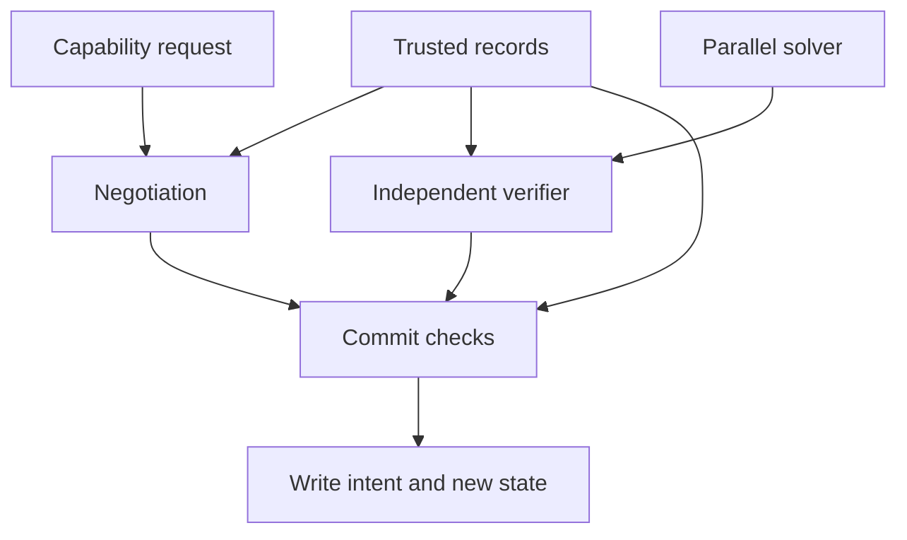

# Enforcement design and adapter contract

The host architecture is now **Genode first**, with direct Linux, native Windows,
and a later kernel using Drift as additional targets. See
[docs/PLATFORMS.md](docs/PLATFORMS.md) for the common contract and source-backed
platform designs. The sections below describe the existing Bend decision model;
the native host integrations remain pending.

## 1. Authority is a monitor-owned state transition

The library is a deterministic decision engine over immutable snapshots. A
proposal has no authority by itself. An enforcing service owns the registries,
graph, principal hierarchy, session records, descriptor table, and ledger.
It authenticates callers before constructing `Frontend.Caller` and obtains
source/delegation/grant facts independently of a caller's request.

Do not deserialize untrusted `Context`, `Session`, `Ledger.State`, `Capability`,
`Binding`, `Ticket`, or `WriteIntent` values and treat them as authority. Their
constructors are public Bend data constructors. Affinity and dependent types do
not turn those descriptions into authenticated grants.

The combined facade resolves the current descriptor and token against the current
registry, checks its authenticated subject against the negotiated reader, compares
the resolved plan to the immutable session plan, then invokes the backplane.
This is the entry point intended for capability-backed adapters.

Everything represented in this diagram is authored in Bend. The external adapter
is responsible for actual persistence, device or network effects, and the
execution boundary protecting the monitor's state.

## 2. Constraint domain

Each node has four components:

| Component | Meaning | Propagation |
| --- | --- | --- |
| Type mask | Possible static atomic type assignments | Intersection along equality constraints |
| Secrecy | Inherited confidentiality compartments | Union along data/control flow |
| Untrusted | Provenance/integrity influences | Union along data/control flow |
| Effects | Required operation capabilities | Union from callee to caller |

The eight atomic types are document, summary, text, bytes, event, tensor, boolean,
and integer. A type mask is a static metavariable domain. Choosing a consistent
assignment is not permission to cast or relabel an arbitrary runtime value.

`flow` includes both explicit and implicit dependencies. A branch on a secret,
a secret-dependent address, output size, error, or termination signal needs a
dependency or a confinement rule. For an opaque worker, its output conservatively
inherits all readable inputs. The library cannot discover omitted dependencies
from arbitrary machine code or hosted languages.

Each solver round reads an immutable previous snapshot and produces an entirely
new one. Type domains shrink and restrictions grow. Empty type domains fail.
The current domain reaches closure within the default N+1 sweep budget; a smaller
explicit budget can fail closed. The producer is not trusted to declare closure.

The independent verifier checks the authoritative original graph: valid indexes,
node count, epochs, nonempty seed-compatible type domains, every source fact,
every data/control edge, every equality edge, and every call-effect edge.
Conservative extra restrictions are allowed. A missing source fact or missing
edge implication is not.

The initial GPU implementation scans the graph's edges at each destination
leaf. It uses balanced binary forks and exact U32 operations with two-word
64-bit masks. This favors inspectable behavior over throughput. Precomputed
adjacency jobs, scheduling by work size, and reduced snapshot sharing are future
optimizations; every such producer must still pass the original verifier.

## 3. Transfer admission

Read and write are distinct authority domains. Neither derives from possession
of a data reference. Each grant independently binds:

- The invocation and complete ordered input manifest, including object versions.
- The exact destination object/version and write domain.
- The code identity, operation kind, live graph/policy/authority epochs, and expiry.

The destination's write approval must agree with the source's approved use. A new
write grant does not reinterpret an old read grant. Source schemas must match the
registered operation's inputs; the output schema must match its registered output.
A copy has exactly one source and preserves its schema.

Every source's inherited origins are retained. Each origin can restrict operation
kinds, approved code identities, confidentiality, integrity provenance, and scoped
payment obligations. Output operation rights are intersected across origins,
sources, and destination. Labels are joined. The intermediate destination's owner
receives no implicit power to discard those restrictions.

`Transfer.Context` represents authenticated and current grants and payment facts.
Code identities compare all 256 bits; the library does not itself hash executable
bytes or verify signatures. A real executor must bind the registered identity to
the code, model, tools, configuration, and input manifest it actually executes.

Payment witnesses attest each source obligation. The reader-expense ledger handles
a separate exact reservation for the negotiation. Both must be satisfied when
required. Duplicate source occurrences are manifest-bound; they do not
automatically create per-occurrence billing.

## 4. Finite decentralized labels

The DLM layer uses a closed registered principal universe for an authority epoch:
top, bottom, and at most 30 named principals. `Edge(actor, granter)` means the
granter delegates to the actor. The layer recomputes and verifies the exact
reflexive/transitive closure, rejecting missing or invented matrix entries.

For observer p, owner o, and candidate reader/writer q, a base policy credits
the owner's restriction only when o acts for p. The atomic predicate is:

`not acts_for(o,p) or acts_for(q,o) or acts_for(q,delegate)`.

Confidentiality join intersects reader sets; confidentiality meet unions them.
Integrity join unions potential-writer sets; integrity meet intersects them.
A permitted flow makes reader sets no larger and potential-writer sets no
smaller. Both directions are checked for every observer in the registered
universe. Empty/public confidentiality is distinct from trusted integrity.

Unknown and compound principals are rejected in this version. New principals
or delegation changes require a new authority epoch. This is not a symbolic
comparison over all possible future Jif principal expressions.

These labels are an additional gate. They do not mint read/write permissions,
owner approvals, execution capabilities, or payments. Declassification and
endorsement are intentionally absent from the executable release path.

## 5. Multiparty transformation negotiation

| Transition | Required evidence |
| --- | --- |
| Proposed → CandidateFixed | Exact request candidate identity; live request and revision |
| CandidateFixed → Challenged | Request-bound challenge issued after pinning, not expired |
| Challenged → Sampled | Pre-execution transfer permission and matching passed sample receipt/nonce |
| Sampled → OwnersApproved | Current approval from every inherited origin for the exact plan |
| OwnersApproved → Reserved | Exact reader/quote/amount/receipt scope and available ledger balance |
| Reserved → Running | Fresh source approvals, paired transfer permission, current budget, live hold |
| Running → Committed | Fresh capability, complete verifier and policy gates, exact single-use ledger commit |

Pinning fixes the candidate named by the request. It does not itself establish
that the operation is approved; `Transfer.admit` checks the registered operation
and paired grants before sample execution, at start, and at commit.

Rejected steps return the original supplied session/state. Samples can detect
some incorrect implementations and inform candidate selection, but an adversary
may pass samples and behave differently later. The sample receipt never removes
labels or source obligations. The sample execution itself must be confined and
authorized before data is read, using `sample_permit`.

Challenges use a 256-bit platform-random nonce helper. The monitor must generate
and register the challenge after the immutable candidate is fixed. Test fixture
nonces are deliberately fixed and are not production challenge material.

The ledger removes funds from available balance at reservation. Commit consumes
the hold and records the invocation; cancellation/expiry refunds it. Receipt IDs
are never recycled. Revisions prevent a transition from accepting a stale supplied
version. The hosting service must perform real compare-and-swap/serialization and
durable persistence; copying an old in-memory ledger is not durable replay defense.

## 6. Final commit and persisted policy

The backplane re-resolves its binding from the immutable full request, including
reader, quote, amount, and deadline. Duplicate bindings for one full request
deny, regardless of registry order. It independently verifies:

1. Current session/ledger revisions, running stage, deadline, and consistent
   graph/policy/authority snapshots.
2. Every origin approval, current budget record, live ledger hold, paired grants,
   operation identity, schemas, provenance, and payment witnesses.
3. The solver candidate against the original graph, its exact declared output
   schema, and actual destination effects. Storage adds a write effect; network,
   display, and device backends add their corresponding effects as well.
4. The finite DLM flow and the combined graph/source labels against the actual
   transfer destination. The write intent carries the combined bitsets, inherited
   origins/operation restrictions, and the joined DLM label.
5. The exact ledger commit for receipt, invocation, payer, amount, expiry, and
   revision.

The facade adds current descriptor/token/subject checks before those gates.
The trusted execution service supplies a binding containing the sealed output's
`ArtifactId`, a full 256-bit digest identity. Commit preserves that exact identity
in the write intent; there is no caller-selected replacement-artifact argument.
This library does not compute the digest or validate a foreign execution receipt.
The adapter must ensure the selected bytes belong to that sealed identity and
were produced by the pinned operation over the complete input manifest.

Returning a write intent does not itself perform IO. The enclosing monitor must
commit updated session, ledger, payload metadata, and actual output as one durable
operation, or use a crash-safe transaction/outbox protocol with the same invocation
identity. This library does not implement the persistence transaction.

## 7. Native authority and file-style interfaces

`Frontend` models a capability mount and descriptor interface. It supports
mount, open, narrowing rights, duplicating a descriptor, closing it, and resolving
an operation against live state. Token comparison uses all 256 bits. Requests
cannot replace the stored plan. Revoked registry entries, changed epochs, expired
handles, cross-subject access, stale revisions, and widened rights are rejected.

The read/write names identify protocol requests. The functions return plans and
decisions, not plaintext or OS descriptors. An actual character-device or mount
adapter must map those requests to this same authority path. An eventual S3
adapter should call the same facade instead of handing out unrestricted raw
storage URLs or allowing alternate write routes.

Genode is the reference native boundary: trusted parent routing establishes
session authority, and the Writ service performs the complete Bend checks.
Direct Linux and Windows hosts must independently establish equivalent semantics
with their own authenticated IPC and confinement. The frontend's numeric records
are not native capability selectors, POSIX descriptors, or Windows HANDLEs.

Possession of a transferable native endpoint does not automatically establish the
original requesting subject. Bind identity and permitted delegation through the
host's trusted session mechanism; deny an ambiguous attribution. The initial
worker topology keeps release authority in the trusted supervisor and supplies
only approved input and private result channels to untrusted transformations.

POSIX remains the first file-style interface, followed by S3. A Linux character
device is a proposed Linux adapter, not the mandatory foundation of Genode or
Windows integration. Neither interface changes the shared authorization rules.

Once a process receives protected plaintext, access through this device alone is
insufficient confinement. The host must gate or disable all other output paths:
preexisting/inherited descriptors, ordinary files and sockets, logs, IPC/shared
memory, descriptor passing, fork/exec, mmap, accelerated copy syscalls, asynchronous
IO, and device/DMA access. Unsupported operations deny. The first hosted executor
can simply inherit the join of every readable input and have no direct IO route.

No hosted transformation runtime, kernel character device, FUSE mount, S3 server,
or driver was authored in another language to disguise this missing OS boundary.
Those adapters remain explicit integration work.

## 8. GPU trust and verification boundary

`!` requests Bend's native GPU path. CPU fallback and sequential JavaScript are
supported by the upstream runtime. This package does not attest which physical
backend executed a call or claim a measured GPU speedup.

The candidate verifier is independent of the propagation algorithm and runs
outside the device call. That catches faulty, incomplete, stale, or fabricated
candidate values. It is not a hardware isolation boundary. Bend's native runtime
uses a unified heap; a malicious driver or arbitrary kernel with access to monitor
memory could corrupt both proposal and authority state. If such components are
outside the trust boundary, use separate protected processes/device domains,
restricted DMA, and authoritative host copies before relying on verification.

The current trusted computing base includes the compiler, Base/runtime, host OS,
drivers, authenticated registry producers, complete dependency extraction, and
the monitor's persistence/effect adapter. The test suite and selected proofs
exercise the library model; they are not a proof of that entire stack.

In particular, `Binding.source_label` and the graph are trusted summaries. A
graph-only secrecy bit cannot reconstruct an omitted origin object identity or
its payment/approval obligations. The monitor must derive the plan from the full
data-and-control source manifest before binding it. Adapters must also bound
request sizes, graph sizes, policy-expression depth, and work before evaluating
untrusted proposals; structural termination alone is not a resource quota.

## 9. External planners and languages

AI and Trealla may propose a `Negotiation.Request`, a candidate operation,
or a solver result through a future transport. They cannot supply trusted
registries, approve for owners, mint paid witnesses, weaken labels, or skip the
deterministic final gate. External runtimes and their parsers are intentionally
not implemented here, matching the staged library scope.

## 10. Proposed views and cooperative operations

The [feature guide](docs/FEATURES.md) extends this design with WritFS, addressable
views, locality-aware execution, origin preparation/release stages, controlled
disclosure, scoped private matching, and cooperative retirement. The
[acceptance index](openspec/FEATURE-ACCEPTANCE.md) links their contracts and the
evidence needed before implementation claims.

These are proposed services and versioned profiles. Current `Core`, `Transfer`,
`Dlm`, `Frontend`, and `Backplane` behavior is unchanged. In particular, ordinary
derivation still accumulates restrictions. A future controlled release preserves
the full original graph/policy and authorizes a separate exact transition over
sealed output; it cannot pass a lowered candidate to the existing verifier.

Namespace presentation, locality preferences, pre/post stages, matching results,
and retirement requests confer no authority of their own. They resolve through
the same authenticated native boundary and current Bend decisions, with durable
replay/accounting and explicit output-disclosure rules.
