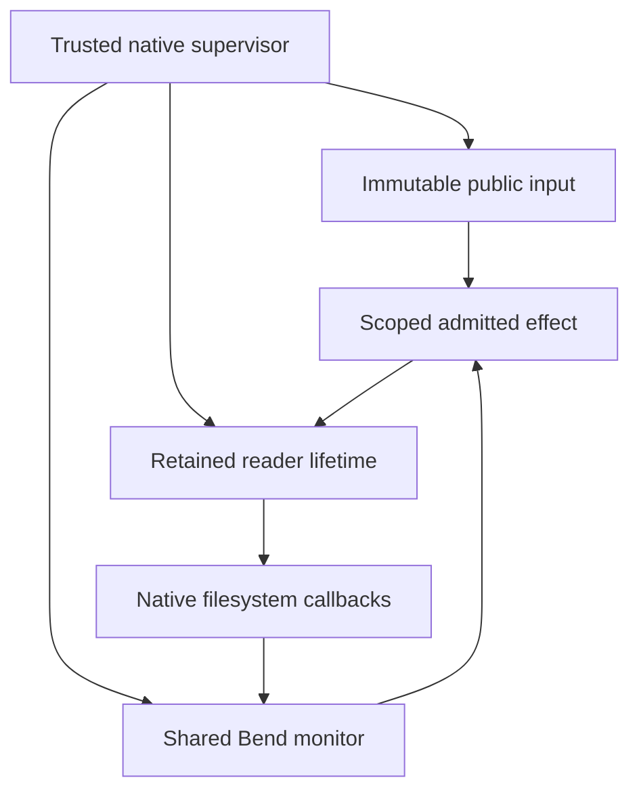

# Native Writ filesystem canaries

Mount one immutable public object as `data`. Let the supervisor's admitted reader
read it, refuse another native caller, then revoke access through the same Bend
state machine. These optional contributions implement that bounded slice on
Windows, Linux and native Genode, outside the core build paths.

This is a foundation for the [filesystem product](../../docs/WRITFS-PRODUCT.md).
Use public fixtures until a complete protected profile qualifies. Containing an
application after it receives plaintext requires its other output channels to
remain controlled.

## One policy, three native presentations

| Target | Native presentation | Reader binding and actual result |
| --- | --- | --- |
| [Windows](windows/README.md) | WinFsp volume with native Win32 callbacks | Retained process lifetime and actual request token at open; mounted reads and revocation pass, complete confinement remains unqualified |
| [Linux](linux/README.md) | Real libfuse mount over a sealed memfd | Kernel UID/GID/PID joined to a pidfd/start time; fixed worker with namespaces, Landlock and seccomp; native gates pass |
| [Genode](genode/README.md) | Native File_system sessions and libc/VFS on x86_64/base-hw | Exact trusted supervisor route joined to a retained session; native packet streams and revoke-only capability; native gates pass |

Build commands, pinned dependencies, source inventories and exact results live
with each target. The [verification record](VERIFICATION.md) distinguishes
policy execution, mounted access and confinement. WSL and Genode-on-Linux are
not substitutes for these native runs.

**Windows confinement remains unqualified.** The zero-capability,
Win32k-disabled LPAC reader completes mounted reads, caller denials and
revocation. Its direct network, clipboard and COM probes cannot initialize,
so the strict confinement command and workflow still fail. Separate no-data
LPAC diagnostics with only `registryRead` added and Win32k enabled pass seven
API checks with and without the owned WFP filters. They never inherit the
admitted actor or input; their results do not replace the missing direct
byte-worker evidence.

The profile has one immutable object of at most 64 KiB, one admitted reader
domain, at most 32 live handles, 65,535 lifetime handles and 100,000 private
protocol frames. It supports read-only metadata, listing, open, bounded ranges,
EOF, close and terminal revocation. Handles never wrap or get reused.

## Where authority lives

[`MountAuthority.bend`](../../writfs/MountAuthority.bend) binds the registered
input to a fixed local standing profile and calls
`DataOS.commit_from_capability`. Admission retains the committed session,
ledger, scoped write intent and origin policy. A successful filesystem open
alone is never release permission.

[`Mount.bend`](../../writfs/Mount.bend) computes SHA-256 from the exact frozen
bytes and owns the mounted-view state, actor eligibility, handle allocation,
read bounds and revocation. The native supervisor privately assigns actor slot
1 from retained OS evidence. Workers cannot submit replacement state, grants,
actor identities or arbitrary monitor commands.

The diagram describes this contribution's request and data path. Genode's
diagnostic clients have LOG capabilities and are not qualified protected workers.

The canonical [WRITFS1 protocol](PROTOCOL.md) is private to the broker and
interpreter. A malformed reply, unexpected sequence, timeout or interpreter loss
retires the uncertain instance. The interpreter adopts the next Bend state
before the host performs an admitted effect. There is no automatic policy
restart or weaker fallback.

Windows and Linux invoke pinned Bend-generated JavaScript through native Node.
Genode invokes the same pure exports through bounded native QuickJS. This is
native OS execution of generated JavaScript, not a general Windows or Genode
machine-code Bend runtime port. Generated modules, dependencies and binaries
remain build artifacts outside the source package.

## Relationship to Btrfs, ZFS and rclone

The [WritFS storage backend](../../writfs/README.md) performs native Btrfs
snapshots and ZFS filesystem/zvol clones. These frontends add native presentation
and reader mediation alongside that primitive. They do not yet expose an entire
staged dataset or implement Btrfs/ZFS internals on Windows or Genode. There is
no new on-disk format.

The [rclone remote](../rclone/README.md) remains a separate contribution with a
minimal Go interface and a Bend service. Native requester identity stays in the
OS bindings rather than passing through rclone. The core library depends on
neither optional contribution.

## Scope of the evidence

Native events associate an operation with a retained process/session context
and a fixed reason. They do not establish human intent. Journals are bounded
diagnostics, not durable, tamper-resistant audit. Public-canary status is an
operator precondition, not a classifier or an authenticated external grant.

Revocation prevents later mediated observations; it cannot erase plaintext
already observed. General issuer integration, dedicated production service
identities, arbitrary applications, all-route confinement, durable audit,
restart recovery and writable publication remain broader product requirements.

The approved exception is documented in [AGENTS.md](AGENTS.md). C/C++ is limited
to OS/runtime ABI, resource ownership, packaging and native probes; JavaScript
is invocation/framing glue. Authorization, labels, accounting and release
decisions stay authored in Bend.
