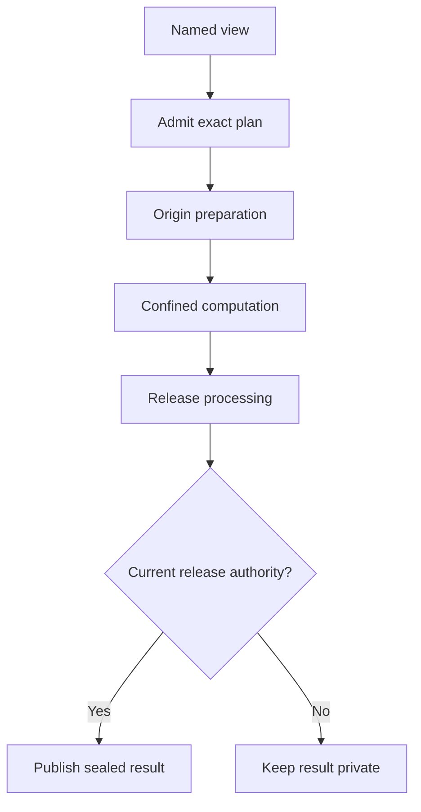

# Work with data where it lives

**Status: proposed features.** The links below lead to contracts, examples, and
unchecked implementation tasks. They do not describe a mounted WritFS, a deployed
private matcher, or a new release path in the current Bend library.

## A summary without downloading the records

A client mounts a scoped Writ session. It can see a view named
`/writ/views/customer-summary`, but cannot read the source customer table.
It explicitly requests materialization under an approved budget.

Writ resolves the source to version 42 and pins the recipe and executor. The
origin's preparation stage selects permitted fields before requester-supplied
code runs. The computation produces a private result. The origin's release
stage validates that result, and the final gate checks the authority to disclose
those exact bytes to the selected recipient.

The source can require raw data to remain at its origin. Placement requirements
filter eligible executors; the first profile ranks approved total cost. The
source's grants, the requester's code and query confidentiality, and the
destination's permissions all matter.

The origin can approve a standing bounded policy; this need not require a human
click for every invocation. Changing a source version, stage, executor, recipient,
or other approved scope requires fresh authorization under that policy.

## Seven small contracts

| Feature | What a caller gets | Specification |
| --- | --- | --- |
| WritFS | A scoped namespace for data, views, jobs, receipts, and control | [WritFS namespace](../openspec/changes/add-writfs-namespace/proposal.md) |
| Addressable views | A name for a permitted computation and its materialized result | [Addressable views](../openspec/changes/add-addressable-views/proposal.md) |
| Locality | Execution within required data boundaries, then approved total-cost ranking | [Locality-aware execution](../openspec/changes/add-locality-aware-execution/proposal.md) |
| Origin stages | Required preparation and release-processing steps around a transform | [Origin stages](../openspec/changes/add-origin-transform-stages/proposal.md) |
| Controlled disclosure | Exact owner-authorized release with original provenance retained | [Controlled disclosure](../openspec/changes/add-controlled-disclosure/proposal.md) |
| Scoped comparison | Bounded overlap results from an explicitly approved search | [Private matching](../openspec/changes/add-scoped-private-matching/proposal.md) |
| Cooperative retirement | Disposal requests and honest receipts for declared managed copies | [Cooperative retirement](../openspec/changes/add-cooperative-retirement/proposal.md) |

Each package has a proposal, design, requirements with concrete scenarios, and
tasks naming the evidence needed to complete it. The
[acceptance index](../openspec/FEATURE-ACCEPTANCE.md) connects the contracts into
whole-operation checks.

## What the mount looks like

These are illustrative paths, not a committed wire format or executable CLI.

| Path | Session-visible meaning |
| --- | --- |
| `/writ/data/report/content` | Authorized content of an exact object version |
| `/writ/views/customer-summary` | An approved derivation, possibly not yet materialized |
| `/writ/jobs/42/state`, `result`, `receipt` | Scoped progress, released output, and evidence |
| `/writ/self/scope`, `limits` | Effective rights and budget without bearer tokens |
| `/writ/control` | Explicit framed requests such as submit, cancel, and retire |

The first profile uses explicit materialization. Listing, opening, statting, or
indexing a mount does not launch computation or create a new execution/query
charge. Metadata and status remain governed by their authorized disclosure and
accounting profile.
The control service accepts complete requests with stable identities and expected
revisions; a partial write or reconnect does not accidentally submit twice.

A pathname supplies a name, not permission. The mounted session supplies the
authenticated binding. Its proc-like information describes authorized Writ work;
host process memory, raw environments, global jobs, and capability tokens are
outside that view. Protected content still needs paired read/write authority,
including authority for the eventual terminal, file, or network sink.

Genode, Linux, and Windows present the same semantics through their qualified
native adapters. A VFS or filesystem plugin is presentation; the authoritative
service remains behind the native protection boundary. Full POSIX compatibility,
an on-disk format, and a specific FUSE or storage-engine implementation are not
chosen by this feature set.

## Names, versions, and location

A view name resolves to a recipe and frozen input versions. Its invocation names
one execution; its result names the actual sealed bytes. A nondeterministic recipe
can produce different results on separate authorized executions. A recipe address
is not a prediction of the output digest.

If `latest` changes while a job waits, the already admitted plan cannot silently
consume the replacement. If an approved executor disappears, Writ cannot move
work to an unapproved host. A cache hit still needs current use authority.
Timeouts preserve an unknown outcome until the original invocation is reconciled.

Required locality filters eligibility. The initial placement profile retains the
existing executor rendezvous rule: lowest approved total quote, then canonical
provider and offer identities. Quotes include the declared movement cost. A
different preference such as paying more for lower latency needs a new versioned
ranking rule and approval; it is not a hidden scheduler adjustment.

## Release changes authority

An ordinary transform retains all input restrictions. The existing library's
labels, graphs, grants, and commit checks keep that rule.

A proposed release view is a distinct versioned value. It retains original
provenance and policy, plus an effective confidentiality policy justified by
authenticated affected-owner authority. The actual result is sealed, the original
graph is independently verified, and the exact release is durably authorized.
Integrity, operation limits, payment, and other owners' restrictions remain.

Dropping a name field does not by itself authorize a new audience. The query can
still reveal an individual through a count or a small cohort. The first release
profile therefore covers registered bounded output contracts, not a generic
promise that an AI scrubber makes arbitrary text anonymous.

## Check an incoming package within a named scope

An importer stages upload U17 privately. Its agreed admission policy requires a
comparison against an approved Project Delta corpus snapshot. Both controllers
have approved the specific matcher and recipient.

| Search term | Example |
| --- | --- |
| Inputs | Import U17 and the complete approved Delta snapshot |
| Method | Exact equality first; a separately registered normalization/chunk matcher later |
| Result | Up to three qualifying matches above a fixed threshold |
| Recipient | The named reviewer; opaque case references and match categories only |
| Limits | Pinned expiry, compute budget, cumulative query allowance, and leakage profile |

The output rule runs inside the trusted matcher or secure computation. Sending
all matches to the client and displaying only three would already disclose too
much. Count, ordering, negative answers, progress, and errors are part of the
output contract. A participant can be authorized to submit an import without
being authorized to observe the reviewer's match verdict.

Admission, quarantine, deletion, callbacks, and file availability also reveal
decisions. If the submitter may not learn a verdict, Writ must withhold those
dependent effects or use an approved uniform response until disposition is
authorized. Hiding a receipt while visibly quarantining only matches is not
private matching.

The first implementation profile is a mutually approved confined service that
can see both inputs. Cryptographic private comparison is a separate qualified
profile: its protocol must protect the promised inputs and enforce the promised
output, input consistency, and completeness. An OPRF alone does not supply those
properties. General semantic similarity is later advisory work.

The response says either a qualifying overlap was found, this complete scoped
search found none, or completion is unknown. An unavailable or partial corpus
cannot produce a clean result. A match establishes neither ownership nor theft;
comparison permission grants neither content access nor deletion authority.

## Retire what the parties agreed to retire

Unlink removes a name. Revocation stops future authorized use. Retirement
coordinates disposal of exact versions and the declared managed replicas,
caches, indexes, and derivatives. A recipient may accept these obligations as
part of the original writ.

The lifecycle records stopped access, quiesced workers/devices, completed managed
disposal, and unresolved offline copies or retention exceptions. A protected
tombstone prevents a backup restore from resurrecting old authority. Shared
physical storage is not destroyed merely because one logical reference retires.

Protected receipts bind the participant and covered actions; recipients receive
only their authorized view. They do not prove that an untrusted party never kept
another copy. A trained model or aggregate needs its
own scoped retirement/recomputation decision; erasing a source row does not
automatically remove its influence.

## Read the evidence separately

The feature contracts are proposed. Current executable evidence remains in
[VERIFICATION.md](../VERIFICATION.md); the existing
[rclone contribution](../contrib/rclone/README.md) is a bounded reference service
with a separate scope. Neither establishes these new native features.

For the source reasoning and documentation conventions used here, see
[feature sources](FEATURE-SOURCES.md). For what must be demonstrated before a
feature is called implemented, use the
[acceptance index](../openspec/FEATURE-ACCEPTANCE.md).
