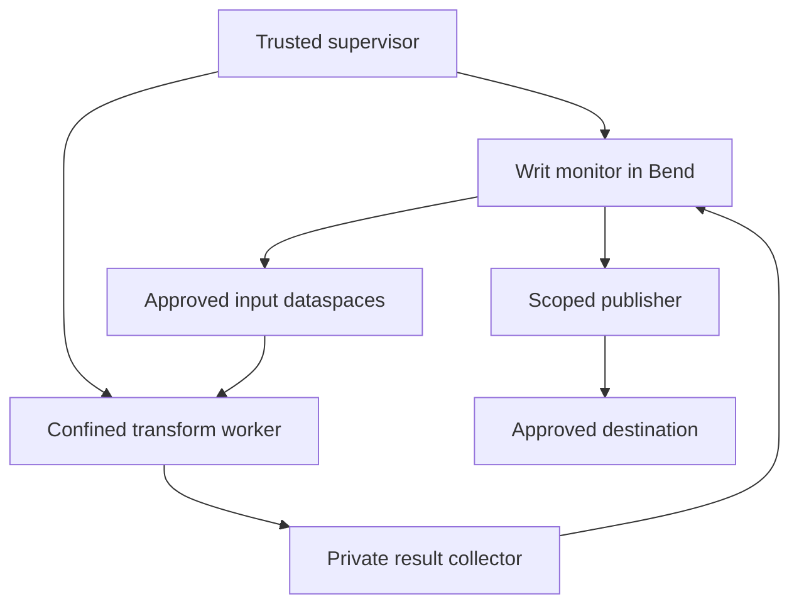

# Genode as Writ's reference host

**Genode is Writ's capability reference; Windows is the first product target.**
A native Genode program can now mount the contributed `File_system` service
through VFS and read its immutable public canary at `/writ/data`. The shared
Bend monitor admits observations and revokes retained handles. Linux FUSE and
Windows WinFsp use the same Bend decisions, with separate native evidence.

This document records the working bounded canary and the remaining protected-host
architecture. The [native contribution](../contrib/native-hosts/genode/README.md)
has a real session service and libc/VFS consumer. Its diagnostic clients have
log capabilities, so the passing mount does not establish a completely confined
worker, safe arbitrary capability delegation or durable publication. Broader
implementation work remains tracked in
[add-genode-host](../openspec/changes/add-genode-host/proposal.md) and the shared
[portable host contract](../openspec/changes/add-portable-host-contract/proposal.md).

## Research baseline

The reference source is **Genode 26.08**, commit
`d18ee9e917200b059549e21f2dd9a55bfe61a0eb`. Its official
[source archive](https://codeberg.org/genodelabs/genode/archive/26.08.tar.gz) was
downloaded and checked against the pin already recorded by
[Drift's Genode SDK](https://github.com/Spaceghost/drift/blob/0b7aaca7f4ff5e3da0570379632f952ecfe754f7/ports/genode/SDK):

```text
df74f96c70c72607d66f5440439680b63683f09edd92809996845f0f29453a74
```

The tested native canary target is **x86_64, base-hw**, under QEMU TCG.
Separate Bend native C runtime development uses `base-linux`; its deployment
qualification remains distinct from the native reference. Foundations 26.05 explicitly
makes capability security conditional on
the selected kernel implementation. A successful run on one base platform does
not establish another's security. [G1]

Genode's current upstream is Codeberg. Its configuration format is HID; new
recipes should follow the pinned source and current documentation rather than
copying old XML recipes. [G2]

## Executing native canary

[Run 41776659987](https://github.com/Spaceghost/writ/actions/runs/41776659987)
passed the clean build and three native boots at
`a66c03e5249d3e507694dbe11070a27aa8024d81`. The
[retained evidence](../contrib/native-hosts/genode/VERIFICATION.md) records:

| Native gate | Result |
| --- | --- |
| Generated Bend core | 782 assertions and 41 HostBinding vectors passed |
| Generated mounted-view policy | All 69 assertions passed, including the full 64 KiB boundary |
| Runtime allocator | 24 native assertions passed; the same host assertions passed ASan, UBSan and leak detection |
| Actual filesystem sessions | 56 assertions passed, including forged labels, malformed shared-memory descriptors, session-local handles and retained-handle revocation |
| Actual libc/VFS mount | Eight assertions passed through `open`, `read`, `lseek`, `fstat` and `close`, with write/unknown-object denial |

The service executes the unchanged Bend-generated `mount.mjs` inside native
QuickJS, with private policy state, a 64 MiB reservation limit and active stack
checks. The C/C++ session/packet binding and bounded allocator adaptation stay
under the approved `contrib/native-hosts/` boundary; policy and release decisions
remain in Bend. Native Node provides the corresponding generated-module path
on Linux and Windows. This is distinct from porting Bend's native C runtime.

The trusted supervisor's exact route binds one retained reader session. The
admitted native session owns its handles; an unadmitted component or forged label
suffix cannot acquire that invocation. This establishes the tested
component/session association, not a person's identity or a general delegation
rule. The initial 600-second corpus timeout, bounded allocation-reuse fix and
successful later runs remain in the evidence record. Full protected-worker
confinement, arbitrary writable files, durable recovery and native Btrfs/ZFS
block storage remain separate acceptance work.

## What Genode gives us

| Genode mechanism | Meaning for Writ |
| --- | --- |
| Protection domains and native capabilities | Isolate monitor memory and restrict which service objects a worker can reach. |
| Parent-mediated session creation | A trusted supervisor selects the services and resource policies available to each child. |
| Server-owned session objects | Writ can expose distinct, scoped endpoints and invalidate their native object identities. |
| RAM dataspaces and region maps | Transfer bounded input/output memory without granting a general storage namespace. |
| RAM and capability quotas | Bound physical resource allocation separately from Writ's reader-paid execution ledger. |

A native capability refers to an RPC object. Its numerical selector belongs to
one protection domain; the same object can have different selectors elsewhere.
Transferring a real capability delegates authority without transferring ownership
of the object. Possession generally permits further delegation. Destroying the
object identity invalidates references to it, subject to the selected platform's
implementation. [G1]

Writ adds rules about **which information may influence which output**: paired
read/write approval, origin terms, operation identity, label propagation, budgets,
and reauthorization at release. Genode supplies mechanisms for application-defined
policies, so this is a composition with its security model. A claim that Writ is
more secure needs a stated threat model and corresponding adversarial evidence.

### Compatibility does not mean identical credentials

Keep native capabilities out of the portable wire format. A Genode selector,
Linux file descriptor, Windows handle, and Writ token are different objects. The
host owns the mapping from a current native endpoint to a Writ authority record;
clients submit proposals and bounded references, not an authoritative `Context`.

Genode RPC dispatch identifies the invoked server object. A delegated session
capability does not by itself identify the original human or the current
invoking component as that human. A proxy is still delegable unless the enclosing
topology and protocol enforce a stronger rule. Preserve Writ's authenticated
reader checks: if an ingress cannot establish the required actor or accepted
delegation scope, deny the request. Do not replace that check with a claimed
subject string or session-capability possession. [G1, G3]

Session labels require similar care. Trusted parents prepend identity and can
rewrite labels; the client controls its resource-selection suffix. Server-side
policy must interpret only the trusted route's meaning. A label received in an
ordinary request body is just text. Genode session labels are also distinct from
Writ's confidentiality and integrity labels. [G4]

## Proposed component layout

The proposed topology for protected transformations keeps policy and commit
capabilities in trusted components. An untrusted transformation receives only approved inputs and a
private result channel. It never receives the general publication capability.



The supervisor constructs and tears down the worker's protection domain and
routes its environment sessions. The monitor owns authenticated policies, the
original graph, principal snapshot, negotiation records, and ledger. The result
collector accepts bounded output into private staging storage. Publication occurs
only through the monitor's current `DataOS.commit_from_capability` decision and
the durable publication protocol.

This topology must account for every environment session and previously granted
capability. Network, terminal, display, logs, reports, shared memory, device access,
and capabilities carried through another RPC can all be output paths. A public
log connection is an output route even when no network service is routed to the
worker. Generic callbacks into client-supplied services are excluded from the
authority path: a nonresponding client could otherwise block the shared monitor.
These are proposed Writ restrictions; Genode's client/server guidance explains
the underlying liveness and shared-memory hazards. [G5]

### Example: the report cannot leave through its encoder

The existing [report-to-summary example](GETTING-STARTED.md) becomes a native
acceptance scenario:

| Attempt | Required result |
| --- | --- |
| Produce an approved internal summary | Retain the report's restrictions and publish only the registered sealed artifact. |
| Encode the same report and request a public destination | The current Writ transfer/label checks deny publication. |
| Send protected bytes to a NIC, terminal, or public log directly | The worker has no usable route to that effect. |
| Reuse an opened session after the underlying grant is revoked | The monitor denies release before the publisher acts. |
| Submit another worker's selector or alter a claimed subject | The ingress establishes no new authority from those values. |

These outcomes must be observed in the native topology. Passing the existing
pure Bend example does not execute any of these host mechanisms.

## Memory, revocation, and reconfiguration

**A sealed Genode dataspace is not automatically an immutable Writ artifact.**
`Pd_session::seal_ram` restricts future attachments; already writable mappings
remain writable. The source implementation sets a permanent seal flag that is
consulted when a new region is attached. [G6]

For the first output path, use broker-owned staging memory, stop every untrusted
writer, and copy into a fresh publication buffer that was never writable by a
worker. Validate the schema and digest over that final copy. Remove the broker's
writable attachment as part of sealing, retain only the intended readers, and
bind those bytes to the registered artifact. Any remaining writer, including a
device mapping, prevents admission as an immutable artifact. This is the proposed
Writ sealing protocol, not a claim that `seal_ram` performs those steps for us.

Revocation likewise has several layers. Closing a Writ descriptor, destroying a
Genode RPC object, cancelling a job, and deleting a dataspace have different
effects. Session closure follows the trusted parent chain; a server that ignores
closure may require parent-enforced teardown. A scoped intermediary can protect
its own service boundary, but it cannot recall bytes already copied by a worker.
Quarantine or terminate the affected worker and retain restrictions on all derived
state. Existing native aliases must never create an alternative release path. [G5]

Genode 26.08's reconfigurable VFS can reopen a handle's path against a changed
filesystem configuration. Therefore a pathname or VFS handle is not Writ's
immutable object-version identity. Reconfiguration must not substitute a different
source or destination under an already approved plan. Re-resolve authoritative
versions and reject mismatches. [G7]

On supervisor or monitor restart, invalidate old channel bindings and reconcile
durable invocations before accepting work. A recycled native selector must not
revive a former grant. RAM/capability quota restoration after teardown does not
refund Writ's execution reservation or erase replay records. [G8]

## base-linux, Bend, and GPU work

The pinned `base-linux` source implements capabilities through Linux socket
descriptors and `SCM_RIGHTS`. Ordinary component startup installs `no_new_privs`
and a synchronized seccomp filter, stopping if installation fails. The filter
allows operations on already available descriptors, so inherited file/socket
authority remains security-relevant. Hybrid components use a separate build and
startup path; their Linux access belongs to the host trust boundary. Treat this
configuration as Genode-on-Linux, distinct from a native Writ Linux broker. [G9]

The current base-hw canary executes the CPU policy corpus through native QuickJS.
Genode's RPC interface remains a C++ framework API, while Bend's separate native
C output depends on memory mapping, threads, synchronization, clocks and IO.
On `base-linux` that C output now runs the full corpus through the inventoried
host-layer memory shim (the runtime rows below); its `base-hw` port and a
parent-recorded fault remain open. The working
generated-JavaScript service does not disable the native C runtime's guard
checks or claim that those primitives have been supplied. All authored Writ
policy and verification remain Bend 2; generated output stays a build artifact.
The approved native binding has its own
[source and trust inventory](../contrib/native-hosts/genode/README.md#source-and-trust-inventory).
[G3, G10]

The broader native C runtime port and ingress are specified in
[add-genode-bend-component](../openspec/changes/add-genode-bend-component/proposal.md):
Bend-authored effects with C twins over one inventoried `extern "C"` shim. The
binding between Genode objects and Writ handles is modeled in Bend by
[add-genode-capability-adoption](../openspec/changes/add-genode-capability-adoption/proposal.md).
The inspected runtime surface is in [BEND-RUNTIME.md](BEND-RUNTIME.md).

Genode has a GPU session interface for buffers, mappings, submission, and
completion. Its own interface documents driver-specific semantics. That does not
establish a compatible Bend CUDA or Metal backend. Start with GPU requests
disabled; qualify any later compute service separately, including its mappings,
DMA isolation, teardown, and physical-backend evidence. The verifier retains its
own authoritative graph/state in a separate protection domain from untrusted
compute. A correct candidate check cannot defend monitor memory that a device is
allowed to overwrite. [G11]

## Remaining protected-host acceptance

The canary already builds a pinned native image and runs the complete current
Bend core and mount corpora in the guest. Full host qualification still requires
the complete report-to-summary topology. Exercise forged references,
delegated endpoints, hostile label suffixes, retained output channels, stale
sessions, mutable artifacts, restarted services, and exhausted quotas. Capture
the actual component routes, kernel/platform identity, build hashes, denials,
and publication observations. Repeat separately for `base-linux`; do not transfer
one platform's evidence to another.

Drift's pinned
[Genode speaker port](https://github.com/Spaceghost/drift/blob/0b7aaca7f4ff5e3da0570379632f952ecfe754f7/ports/genode/README.md)
provides an existing service/client and missing-resource example to learn from.
It is a driver integration example, not evidence that Writ confinement or a future
kernel already works.

## Primary references

All source links below refer to the inspected Genode 26.08 revision.

- **G1 — Capability model:** [Foundations 26.05](https://genode.org/documentation/genode-foundations/26.05/architecture/Capability-based_security.html).
- **G2 — Upstream and configuration:** [official repository](https://genode.org/download/repository), [26.02 HID transition](https://genode.org/documentation/release-notes/26.02), and [HID syntax](https://genode.org/documentation/genode-foundations/26.05/system_configuration/Human-inclined_data_%28HID%29_syntax.html).
- **G3 — RPC source:** [capability.h](https://codeberg.org/genodelabs/genode/src/commit/d18ee9e917200b059549e21f2dd9a55bfe61a0eb/repos/base/include/base/capability.h) and [rpc_server.h](https://codeberg.org/genodelabs/genode/src/commit/d18ee9e917200b059549e21f2dd9a55bfe61a0eb/repos/base/include/base/rpc_server.h).
- **G4 — Session policy:** [init and labels](https://genode.org/documentation/genode-foundations/26.05/system_configuration/The_init_component.html), [routing implementation](https://codeberg.org/genodelabs/genode/src/commit/d18ee9e917200b059549e21f2dd9a55bfe61a0eb/repos/os/src/lib/sandbox/child.cc), and [label matching](https://codeberg.org/genodelabs/genode/src/commit/d18ee9e917200b059549e21f2dd9a55bfe61a0eb/repos/os/src/lib/sandbox/utils.h).
- **G5 — Session lifetime and hostile clients:** [recursive system structure](https://genode.org/documentation/genode-foundations/26.05/architecture/Recursive_system_structure.html).
- **G6 — Sealing:** [PD interface](https://codeberg.org/genodelabs/genode/src/commit/d18ee9e917200b059549e21f2dd9a55bfe61a0eb/repos/base/include/pd_session/pd_session.h), [dataspace factory](https://codeberg.org/genodelabs/genode/src/commit/d18ee9e917200b059549e21f2dd9a55bfe61a0eb/repos/base/src/core/ram_dataspace_factory.cc), and [region-map attachment](https://codeberg.org/genodelabs/genode/src/commit/d18ee9e917200b059549e21f2dd9a55bfe61a0eb/repos/base/src/core/region_map_component.cc).
- **G7 — VFS reconfiguration:** [Genode 26.08 release notes](https://genode.org/documentation/release-notes/26.08).
- **G8 — Memory and quotas:** [core services](https://genode.org/documentation/genode-foundations/26.05/architecture/Core_-_the_root_of_the_component_tree.html).
- **G9 — Linux implementation:** [IPC](https://codeberg.org/genodelabs/genode/src/commit/d18ee9e917200b059549e21f2dd9a55bfe61a0eb/repos/base-linux/src/lib/base/ipc.cc), [startup filter](https://codeberg.org/genodelabs/genode/src/commit/d18ee9e917200b059549e21f2dd9a55bfe61a0eb/repos/base-linux/src/lib/base/runtime.cc), [filter generator](https://codeberg.org/genodelabs/genode/src/commit/d18ee9e917200b059549e21f2dd9a55bfe61a0eb/tool/seccomp/seccomp_bpf_compiler.h), and [hybrid build](https://codeberg.org/genodelabs/genode/src/commit/d18ee9e917200b059549e21f2dd9a55bfe61a0eb/repos/base-linux/lib/mk/lx_hybrid.mk).
- **G10 — Pinned Bend and current evidence:** [Bend 2.0.39](https://github.com/bendlang/bend/releases/tag/v2.0.39) and [Writ verification record](../VERIFICATION.md); the generated native output has since been compiled for `base-linux` and, with the host-layer shim, runs the hello, the 782-check corpus, and the four examples there (see the base-linux runtime-row section below, which also lists the open gaps).
- **G11 — GPU API:** [gpu_session.h](https://codeberg.org/genodelabs/genode/src/commit/d18ee9e917200b059549e21f2dd9a55bfe61a0eb/repos/os/include/gpu_session/gpu_session.h).

## Runtime rows on base-linux, 2026-11

The unmodified C that Bend 2.0.39 emits for Bend programs now runs as Genode
26.08 components on `base-linux` (Genode-on-Linux, not a native kernel),
linked with the host-layer memory shim. The one-line `IO.print` hello prints
`hi` and exits 0, and `Tests.bend` passes all 782 checks at a 256M quota,
with a log that matches the Linux single-lane run line for line. The open
gaps: when a component faults it is terminated, but the parent (init)
records nothing; only single-lane runs (`--threads 1`) have been made;
threads are still shown only by C probes; and the clock is shown through a
Bend program only on the shim's Timer session (`Genode.now`/`Genode.sleep`),
not through libc's (`IO.now`/`IO.sleep`). The per-row record, with
commands, log lines, source citations, and whether each row came from a Bend
program, a plain-C probe, or source reading, is
[genode-runtime-rows-base-linux.md](../verification/genode-runtime-rows-base-linux.md);
the build itself is in
[genode-bend-hello-base-linux.txt](../verification/genode-bend-hello-base-linux.txt).
The list below is the record from before the host-layer shim; the subsections
after it give the current memory, fault, event-loop, and corpus results.

- **Memory: reservation substituted, guard missing, `munmap` unverified.** Genode's libc `mmap` for anonymous
  memory (`repos/libports/src/lib/libc/file_operations.cc:648-671`) allocates
  the whole length from libc's heap and zeroes it, so the runtime's fixed
  8 GiB term heap is committed RAM: a component needs more than 10 GiB of
  quota for `--threads 1`, and at 256M it blocks on a resource request
  instead of failing. `mprotect` is a weak dummy returning -1
  (`dummies.cc:126`), so the evaluation stack's guard page cannot be made and
  the runtime exits with `bend: stack guard failed`. `mprotect` is not stubbed
  to a no-op, because that would silently remove the stack-overflow fail-stop.
- **Faults: the runtime's own handler is missing.** libc's `sigaction` only
  fills an emulated table; base-linux handles hardware faults itself and
  lets Linux kill the process. A C probe that overflows its stack was
  terminated and did not resume, but init recorded nothing.
- Threads, the monotonic clock, the event loop's pipe and `select`, and the
  process calls (`BENDRTS`, exit status) are supplied by libc, as shown by C
  probes. The event loop is supplied with a `vfs_pipe` mount and the libc
  `pipe` attribute in its configuration. A 100 ms `nanosleep` returned
  slightly early in two of four clock runs. Atomics are unverified (compiled,
  not executed), and device dispatch is CPU only by construction.

Fault-substitute decision: the profile's halting substitute is the base
platform's fault path, which ends the component with no resumption. GB-003
also requires the parent to record the fault, and on `base-linux` it does
not, so that requirement stays open. `base-hw` must be measured separately.

The next step is a host-layer fix, outside Bend: a Genode-side `mprotect`
that changes the guard range's attachment in the component's region map,
supplied either inside the GB-006 shim (inventoried with it) or as a libports
patch with its own pin, plus an anonymous mapping that reserves address space
and backs it on demand instead of committing 8 GiB (a Genode-side change). A
runtime heap-size option for the fixed 8 GiB reservation would be a change to
Bend's runtime upstream, not to Genode 26.08. Until then, the threads, clock,
event-loop, and fault rows are established only by plain-C probes, which
stand in for the Bend program.

### Host-layer memory probe (base-linux, 2026-11)

The memory half of the next step now exists as host binding code in
[hosts/genode/shim/writ_mem.cc](../hosts/genode/shim/writ_mem.cc). It first
ran with a plain-C probe (below), then with the Bend hello and corpus. A qualifying anonymous
`mmap` (at least 1 GiB, read-write, private) becomes a region map from an RM
session attached into the component. Nothing is backed until a touch. Then a
2 MiB RAM dataspace from the component's own PD is attached at the touched
chunk. `mprotect(PROT_NONE)` turns a range into a guard: overlapping chunks
are re-attached around it, and a touch there is refused and kills the
component. Under a 256M quota, an 8 GiB reservation cost 233472 bytes of
metadata. Six touches charged exactly five 2 MiB chunks. Writes into a guard
ended the component, both for a guard inside one chunk and for one that
straddles a chunk boundary. Running out of RAM or cap quota also ended it
with a refusal line instead of hanging on a resource request (record:
[genode-reservation-probe-base-linux.txt](../verification/genode-reservation-probe-base-linux.txt)).

Two base-linux facts limit this result. First, Genode does not deliver
region-map fault signals on Linux, so the shim fills chunks from a Linux
SIGSEGV handler it installs itself. Kernels that deliver region-map faults
need a separate front end, which has not been built. Second, init still
recorded nothing when the component died, so GB-003's parent-record
requirement stays open on base-linux.

The shim is now linked into the Bend component `writ_bend_hello`, in place
of `posix`. The unmodified generated hello C prints `hi` under init on
base-linux and exits with value 0 at ram 256M. At exit the component had
used about 7.9 MiB of its quota: the 8 GiB term heap and the 2 GiB
evaluation stack are reservations, three 2 MiB chunks were charged, and the
stack guard has no dataspace behind it. On base-linux the guard is a
PROT_NONE Linux reservation that base-linux leaves when a piece is detached
(`Region_map_mmap::detach` calls `_reserve_local`,
`repos/base-linux/src/lib/base/region_map_mmap.cc:401-405`), not an
unmapped hole; a touch faults either way, and every run script fails if
base-linux logs `_reserve_local unexpectedly failed`. The run script mounts `vfs_pipe` for
the event loop's pipe and passes `+RTS --threads 1 --gpu off` as arguments.
`-DMAP_NORESERVE=0` is still needed, because the libc headers lack the name.
The runtime's own `err_trap` cannot run on base-linux, because libc only
emulates `sigaction`. A guard touch would print the shim's refusal line
instead of `bend: memory fault`. The record is the host-layer section of
[genode-bend-hello-base-linux.txt](../verification/genode-bend-hello-base-linux.txt);
the guard touch through a Bend program is in the next subsection.

### The test corpus and the fault row as Bend components (base-linux, 2026-11)

Example: `make run/writ_bend_tests` in the Genode build directory starts the
unmodified generated C of `Tests.bend`, linked with the shim, under init on
base-linux at ram 256M with `+RTS --threads 1 --gpu off`. It logs 782 PASS
lines and `ALL LIBRARY TESTS PASSED` and exits with value 0, having used
about 12 MiB of its quota. Its 834 lines are byte-identical to a fresh Linux
single-lane run of the same tree (merged with master at d8b1473; the earlier
764-check tree matched the same way). The four examples (`Example.bend`,
`examples/Flow.bend`, `examples/Transfer.bend`, `GpuExample.bend`) also run
at 256M, and each log matches its Linux capture line for line. Each of the
four example run scripts embeds its capture and fails if a line changes; the
corpus script checks the PASS count and the final line, and the full
comparison is in
[genode-corpus-base-linux.txt](../verification/genode-corpus-base-linux.txt). All of this is CPU
only. GpuExample's dispatch line is text the program prints, not device
evidence.

Current gap: the parent still records nothing when a component faults. The
fault row ran through a Bend program, `scripts/runtime-profile/Overflow.bend`.
At 256M the shim refused a stack chunk for lack of RAM quota and the
component died. At 3G with 1000 caps it ran out of caps, because each 2 MiB
chunk is a dataspace capability. At 3G with 2000 caps the recursion reached
the runtime's real stack guard. In every case the shim logged `unresolved
fault ... (guard page), component terminates` (or the quota reason), the
process was gone, nothing resumed, and init logged nothing about the child.
The runtime's own `bend: memory fault` line cannot appear on base-linux.
The fault row is therefore a substitute that covers termination only, and
GB-003's parent-record requirement stays open. Threads and the clock are
still established only by C probes, and no Bend program here ran two lanes.
Records: [genode-corpus-base-linux.txt](../verification/genode-corpus-base-linux.txt),
[genode-corpus-linux-reference.txt](../verification/genode-corpus-linux-reference.txt),
and the updated rows in
[genode-runtime-rows-base-linux.md](../verification/genode-runtime-rows-base-linux.md).

Console and time effects (channel lane, Task 1): `make run/writ_bend_probe`
runs `hosts/genode/monitor/Probe.bend`, which calls the Bend effects
`Genode.log`, `Genode.now`, and `Genode.sleep` from
`hosts/genode/effects/Genode.bend`. Their `.c` twins call only the shim's
`writ_shim_log`, `writ_shim_now_ms`, and `writ_shim_sleep_ms` (same shim
unit, over the component's LOG session and a Timer session). With libc's
stdout on `/dev/null`, the probe's text still reached the LOG
(`[init -> writ_bend_probe] probe: hello from Bend through the Genode LOG
session`), and its readings around `Genode.sleep(100)` differed by 101 to
102 ms at 256M; the probe accepts only ordered readings with a delta in
[100, 1100) ms, and its failure branch exits 1. A missing Timer route ends
the component with one `writ_shim:` line and exit value 1. Current gap:
these effects are host rows beyond the monitor profile (`check-binary.sh`
lists exactly the three) and are not yet admitted to it. Record:
[genode-effects-base-linux.txt](../verification/genode-effects-base-linux.txt).

Writ channel (channel lane, Task 2): `make run/writ_bend_monitor_accept`
starts the Bend monitor `hosts/genode/monitor/Monitor.bend` as the component
`writ_bend_monitor`, which serves a `Writ_channel` session, and a client
probe started as the child `writ_client_r`. Init routes the client's session
to the monitor; the monitor's `<writ_channel><policy
label_prefix="writ_client_r ->" subject="1"/>` gives that channel route
subject 1, the Scenario's reader R. The client writes a 64-byte
report-to-summary request into its 4 KiB request bucket and signals;
`Genode.take` yields the record with the route subject, the monitor decides
through `DataOS.commit_from_capability` over the synthetic
`examples/Scenario.bend` state, and `Genode.put` writes the decision record
to the result bucket and signals back: `decision=Committed`. In
`make run/writ_bend_monitor_substitute` the same route sends a body that
claims subject S and names S's session; Bend still evaluates R and the
library rejects it (`decision=Denied reason=6`); routed as S
(`make run/writ_bend_monitor_routed_s`) the same body is refused earlier at
the descriptor (`reason=5`), and R with a body claiming S
(`make run/writ_bend_monitor_claim_ignored`) is Committed. The monitor binds
one descriptor to each channel at its first record and reuses it, and
drops the binding when the shim reports the channel closed. The
session type has only four capability-handover RPC functions (two buckets,
two signals); records carry the requests and decisions (GB-011). Bounds
and liveness (Task 3): `make run/writ_bend_monitor_bad_length` sends
header lengths 65, 0, and 0xFFFFFFFF, which the shim counts and answers with its fixed
transport refusal (kind 3, decision 3, reason 256, no Writ decision) before Bend, then
a valid request that Bend commits; `make run/writ_bend_monitor_liveness`
runs a client that floods without ever reading a reply beside one that
sends once and is Committed, until the monitor's fuel runs out and init
reports its exit value 0; `make run/writ_bend_monitor_dead_client` shows a
client that exits before its reply and one that frees its result signal
context do not stop a third client from being served; a close event costs the monitor one unit of fuel
like a record. `make run/writ_bend_monitor_queue` opens 8 channels, refuses a ninth
session, and serves the queued channels in ring order until the fuel runs
out; coalescing of repeated signals is not reliably exercised. Current gap: one record per bucket, nothing
restarts the monitor after fuel exhaustion (GB-008's supervisor restart),
the fuel is global so any client can end the service, whether the reply
signal can block the loop on base-linux beyond the cases run is not shown,
and `base-hw` is not attempted. Record formats:
[Channel.md](../hosts/genode/effects/Channel.md); evidence:
[genode-channel-base-linux.txt](../verification/genode-channel-base-linux.txt).
