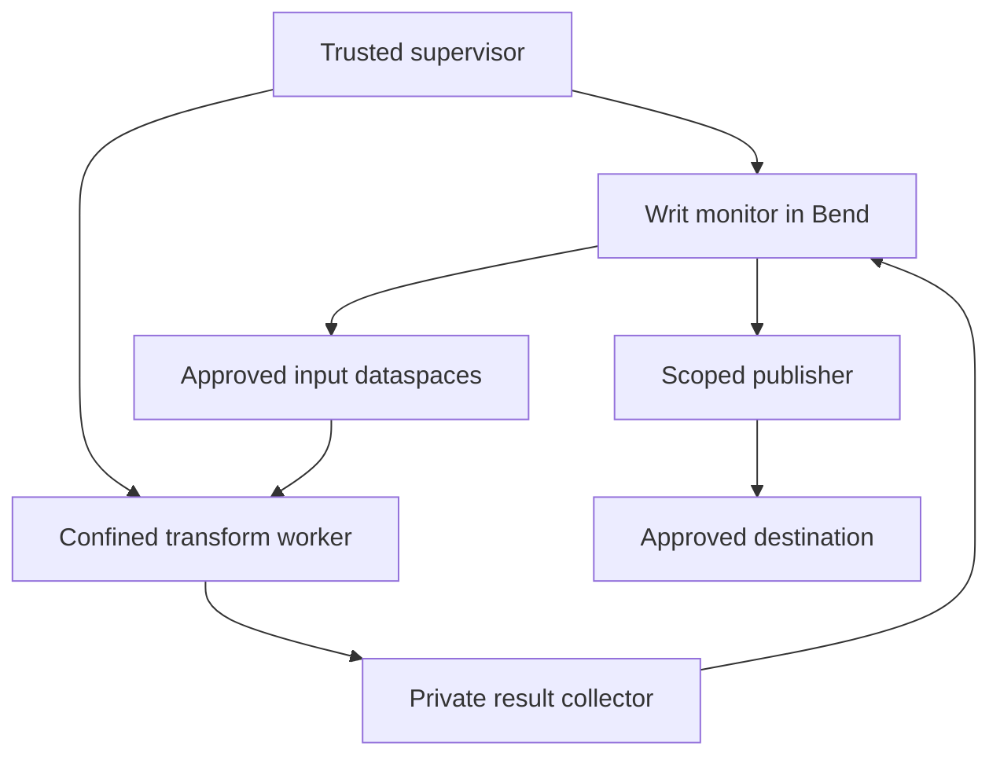

# Genode as Writ's reference host

**Build Writ's enforcing environment on Genode's capability machinery. Keep the
information-flow rules and final authority checks in Bend 2.** The same Writ
contract will also have Linux, Windows, and later Drift-backed kernel hosts; their
native object handles and isolation mechanisms need separate validation.

This document records researched mechanisms and a proposed integration. There is
no Writ Genode executable, session service, or live confinement result yet. The
implementation work is tracked in
[add-genode-host](../openspec/changes/add-genode-host/proposal.md) and the shared
[portable host contract](../openspec/changes/add-portable-host-contract/proposal.md).

## Research baseline

The reference source is **Genode 26.08**, commit
`d18ee9e917200b059549e21f2dd9a55bfe61a0eb`. Its official
[source archive](https://codeberg.org/genodelabs/genode/archive/26.08.tar.gz) was
downloaded and checked against the pin already recorded by
[Drift's Genode SDK](https://github.com/Spaceghost/drift/blob/0b7aaca7f4ff5e3da0570379632f952ecfe754f7/ports/genode/SDK):

```text
df74f96c70c72607d66f5440439680b63683f09edd92809996845f0f29453a74
```

The first native reference target is **x86_64, base-hw**, initially under QEMU.
Initial runtime/session development starts on `base-linux`; its deployment
qualification is distinct from the native reference. Foundations 26.05 explicitly
makes capability security conditional on
the selected kernel implementation. A successful run on one base platform does
not establish another's security. [G1]

Genode's current upstream is Codeberg. Its configuration format is HID; new
recipes should follow the pinned source and current documentation rather than
copying old XML recipes. [G2]

## What Genode gives us

| Genode mechanism | Meaning for Writ |
| --- | --- |
| Protection domains and native capabilities | Isolate monitor memory and restrict which service objects a worker can reach. |
| Parent-mediated session creation | A trusted supervisor selects the services and resource policies available to each child. |
| Server-owned session objects | Writ can expose distinct, scoped endpoints and invalidate their native object identities. |
| RAM dataspaces and region maps | Transfer bounded input/output memory without granting a general storage namespace. |
| RAM and capability quotas | Bound physical resource allocation separately from Writ's reader-paid execution ledger. |

A native capability refers to an RPC object. Its numerical selector belongs to
one protection domain; the same object can have different selectors elsewhere.
Transferring a real capability delegates authority without transferring ownership
of the object. Possession generally permits further delegation. Destroying the
object identity invalidates references to it, subject to the selected platform's
implementation. [G1]

Writ adds rules about **which information may influence which output**: paired
read/write approval, origin terms, operation identity, label propagation, budgets,
and reauthorization at release. Genode supplies mechanisms for application-defined
policies, so this is a composition with its security model. A claim that Writ is
more secure needs a stated threat model and corresponding adversarial evidence.

### Compatibility does not mean identical credentials

Keep native capabilities out of the portable wire format. A Genode selector,
Linux file descriptor, Windows handle, and Writ token are different objects. The
host owns the mapping from a current native endpoint to a Writ authority record;
clients submit proposals and bounded references, not an authoritative `Context`.

Genode RPC dispatch identifies the invoked server object. A delegated session
capability does not by itself identify the original human or the current
invoking component as that human. A proxy is still delegable unless the enclosing
topology and protocol enforce a stronger rule. Preserve Writ's authenticated
reader checks: if an ingress cannot establish the required actor or accepted
delegation scope, deny the request. Do not replace that check with a claimed
subject string or session-capability possession. [G1, G3]

Session labels require similar care. Trusted parents prepend identity and can
rewrite labels; the client controls its resource-selection suffix. Server-side
policy must interpret only the trusted route's meaning. A label received in an
ordinary request body is just text. Genode session labels are also distinct from
Writ's confidentiality and integrity labels. [G4]

## Proposed component layout

The first reference topology keeps policy and commit capabilities in trusted
components. An untrusted transformation receives only approved inputs and a
private result channel. It never receives the general publication capability.



The supervisor constructs and tears down the worker's protection domain and
routes its environment sessions. The monitor owns authenticated policies, the
original graph, principal snapshot, negotiation records, and ledger. The result
collector accepts bounded output into private staging storage. Publication occurs
only through the monitor's current `DataOS.commit_from_capability` decision and
the durable publication protocol.

This topology must account for every environment session and previously granted
capability. Network, terminal, display, logs, reports, shared memory, device access,
and capabilities carried through another RPC can all be output paths. A public
log connection is an output route even when no network service is routed to the
worker. Generic callbacks into client-supplied services are excluded from the
authority path: a nonresponding client could otherwise block the shared monitor.
These are proposed Writ restrictions; Genode's client/server guidance explains
the underlying liveness and shared-memory hazards. [G5]

### Example: the report cannot leave through its encoder

The existing [report-to-summary example](GETTING-STARTED.md) becomes a native
acceptance scenario:

| Attempt | Required result |
| --- | --- |
| Produce an approved internal summary | Retain the report's restrictions and publish only the registered sealed artifact. |
| Encode the same report and request a public destination | The current Writ transfer/label checks deny publication. |
| Send protected bytes to a NIC, terminal, or public log directly | The worker has no usable route to that effect. |
| Reuse an opened session after the underlying grant is revoked | The monitor denies release before the publisher acts. |
| Submit another worker's selector or alter a claimed subject | The ingress establishes no new authority from those values. |

These outcomes must be observed in the native topology. Passing the existing
pure Bend example does not execute any of these host mechanisms.

## Memory, revocation, and reconfiguration

**A sealed Genode dataspace is not automatically an immutable Writ artifact.**
`Pd_session::seal_ram` restricts future attachments; already writable mappings
remain writable. The source implementation sets a permanent seal flag that is
consulted when a new region is attached. [G6]

For the first output path, use broker-owned staging memory, stop every untrusted
writer, and copy into a fresh publication buffer that was never writable by a
worker. Validate the schema and digest over that final copy. Remove the broker's
writable attachment as part of sealing, retain only the intended readers, and
bind those bytes to the registered artifact. Any remaining writer, including a
device mapping, prevents admission as an immutable artifact. This is the proposed
Writ sealing protocol, not a claim that `seal_ram` performs those steps for us.

Revocation likewise has several layers. Closing a Writ descriptor, destroying a
Genode RPC object, cancelling a job, and deleting a dataspace have different
effects. Session closure follows the trusted parent chain; a server that ignores
closure may require parent-enforced teardown. A scoped intermediary can protect
its own service boundary, but it cannot recall bytes already copied by a worker.
Quarantine or terminate the affected worker and retain restrictions on all derived
state. Existing native aliases must never create an alternative release path. [G5]

Genode 26.08's reconfigurable VFS can reopen a handle's path against a changed
filesystem configuration. Therefore a pathname or VFS handle is not Writ's
immutable object-version identity. Reconfiguration must not substitute a different
source or destination under an already approved plan. Re-resolve authoritative
versions and reject mismatches. [G7]

On supervisor or monitor restart, invalidate old channel bindings and reconcile
durable invocations before accepting work. A recycled native selector must not
revive a former grant. RAM/capability quota restoration after teardown does not
refund Writ's execution reservation or erase replay records. [G8]

## base-linux, Bend, and GPU work

The pinned `base-linux` source implements capabilities through Linux socket
descriptors and `SCM_RIGHTS`. Ordinary component startup installs `no_new_privs`
and a synchronized seccomp filter, stopping if installation fails. The filter
allows operations on already available descriptors, so inherited file/socket
authority remains security-relevant. Hybrid components use a separate build and
startup path; their Linux access belongs to the host trust boundary. Treat this
configuration as Genode-on-Linux, distinct from a native Writ Linux broker. [G9]

For Bend, begin with the CPU policy path and the existing denial corpus. Genode's
RPC interface is a C++ framework API, while the pinned Bend native output depends
on a runtime with memory mapping, threads, synchronization, clocks, and IO. A
working runtime/ABI port is a prerequisite, not supplied by the `.bend` extension.
All authored Writ policy and verification remain Bend 2. Generated native output
stays a build artifact. No handwritten C/C++ policy substitute or untested native
bridge is included here. [G3, G10]

Genode has a GPU session interface for buffers, mappings, submission, and
completion. Its own interface documents driver-specific semantics. That does not
establish a compatible Bend CUDA or Metal backend. Start with GPU requests
disabled; qualify any later compute service separately, including its mappings,
DMA isolation, teardown, and physical-backend evidence. The verifier retains its
own authoritative graph/state in a separate protection domain from untrusted
compute. A correct candidate check cannot defend monitor memory that a device is
allowed to overwrite. [G11]

## What must be demonstrated before declaring support

Build a pinned native image, run the Bend policy corpus inside the monitor, and
exercise the complete report-to-summary scenario. Then try forged references,
delegated endpoints, hostile label suffixes, retained output channels, stale
sessions, mutable artifacts, restarted services, and exhausted quotas. Capture
the actual component routes, kernel/platform identity, build hashes, denials,
and publication observations. Repeat separately for `base-linux`; do not transfer
one platform's evidence to another.

Drift's pinned
[Genode speaker port](https://github.com/Spaceghost/drift/blob/0b7aaca7f4ff5e3da0570379632f952ecfe754f7/ports/genode/README.md)
provides an existing service/client and missing-resource example to learn from.
It is a driver integration example, not evidence that Writ confinement or a future
kernel already works.

## Primary references

All source links below refer to the inspected Genode 26.08 revision.

- **G1 — Capability model:** [Foundations 26.05](https://genode.org/documentation/genode-foundations/26.05/architecture/Capability-based_security.html).
- **G2 — Upstream and configuration:** [official repository](https://genode.org/download/repository), [26.02 HID transition](https://genode.org/documentation/release-notes/26.02), and [HID syntax](https://genode.org/documentation/genode-foundations/26.05/system_configuration/Human-inclined_data_%28HID%29_syntax.html).
- **G3 — RPC source:** [capability.h](https://codeberg.org/genodelabs/genode/src/commit/d18ee9e917200b059549e21f2dd9a55bfe61a0eb/repos/base/include/base/capability.h) and [rpc_server.h](https://codeberg.org/genodelabs/genode/src/commit/d18ee9e917200b059549e21f2dd9a55bfe61a0eb/repos/base/include/base/rpc_server.h).
- **G4 — Session policy:** [init and labels](https://genode.org/documentation/genode-foundations/26.05/system_configuration/The_init_component.html), [routing implementation](https://codeberg.org/genodelabs/genode/src/commit/d18ee9e917200b059549e21f2dd9a55bfe61a0eb/repos/os/src/lib/sandbox/child.cc), and [label matching](https://codeberg.org/genodelabs/genode/src/commit/d18ee9e917200b059549e21f2dd9a55bfe61a0eb/repos/os/src/lib/sandbox/utils.h).
- **G5 — Session lifetime and hostile clients:** [recursive system structure](https://genode.org/documentation/genode-foundations/26.05/architecture/Recursive_system_structure.html).
- **G6 — Sealing:** [PD interface](https://codeberg.org/genodelabs/genode/src/commit/d18ee9e917200b059549e21f2dd9a55bfe61a0eb/repos/base/include/pd_session/pd_session.h), [dataspace factory](https://codeberg.org/genodelabs/genode/src/commit/d18ee9e917200b059549e21f2dd9a55bfe61a0eb/repos/base/src/core/ram_dataspace_factory.cc), and [region-map attachment](https://codeberg.org/genodelabs/genode/src/commit/d18ee9e917200b059549e21f2dd9a55bfe61a0eb/repos/base/src/core/region_map_component.cc).
- **G7 — VFS reconfiguration:** [Genode 26.08 release notes](https://genode.org/documentation/release-notes/26.08).
- **G8 — Memory and quotas:** [core services](https://genode.org/documentation/genode-foundations/26.05/architecture/Core_-_the_root_of_the_component_tree.html).
- **G9 — Linux implementation:** [IPC](https://codeberg.org/genodelabs/genode/src/commit/d18ee9e917200b059549e21f2dd9a55bfe61a0eb/repos/base-linux/src/lib/base/ipc.cc), [startup filter](https://codeberg.org/genodelabs/genode/src/commit/d18ee9e917200b059549e21f2dd9a55bfe61a0eb/repos/base-linux/src/lib/base/runtime.cc), [filter generator](https://codeberg.org/genodelabs/genode/src/commit/d18ee9e917200b059549e21f2dd9a55bfe61a0eb/tool/seccomp/seccomp_bpf_compiler.h), and [hybrid build](https://codeberg.org/genodelabs/genode/src/commit/d18ee9e917200b059549e21f2dd9a55bfe61a0eb/repos/base-linux/lib/mk/lx_hybrid.mk).
- **G10 — Pinned Bend and current evidence:** [Bend 2.0.39](https://github.com/bendlang/bend/releases/tag/v2.0.39) and [Writ verification record](../VERIFICATION.md); native output was inspected, not compiled for Genode.
- **G11 — GPU API:** [gpu_session.h](https://codeberg.org/genodelabs/genode/src/commit/d18ee9e917200b059549e21f2dd9a55bfe61a0eb/repos/os/include/gpu_session/gpu_session.h).
