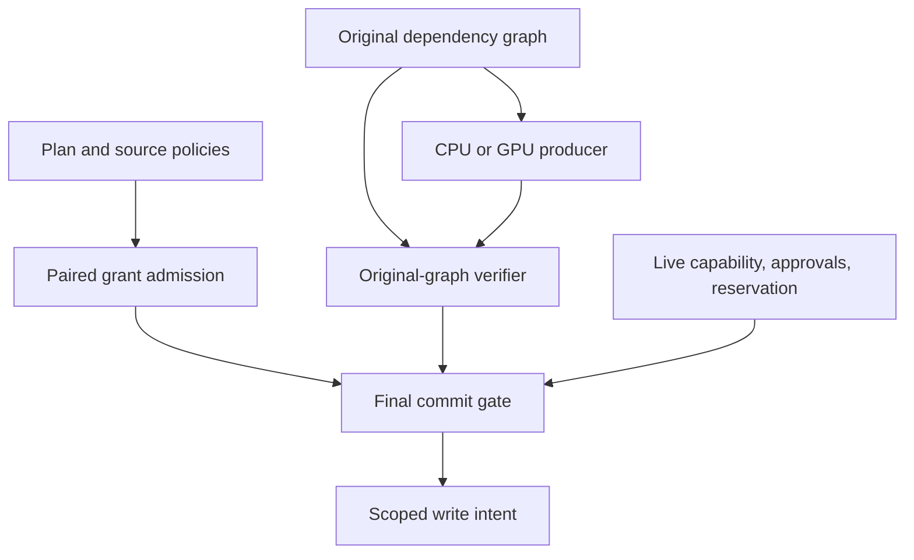

# From a restricted report to an approved summary

Writ answers a specific question: **may this operation move these exact inputs to
this exact destination under the authority that exists now?**

The examples use a restricted incident report and an internal summary. The report
belongs to the incident team and contains reporter-supplied information. A summary
must keep both facts: shortening the report does not make it public or establish
that its claims are trustworthy.

Install [Bend 2.0.39](INSTALL.md), then run the commands below from the repository
root. Every example checks its own expected outcomes and fails with a nonzero exit
status if they change. See [examples/README.md](../examples/README.md) for the exact
output of each run.

## The example's vocabulary

| Record | Meaning in this story |
| --- | --- |
| Source object | Version 1 of the incident report |
| Destination object | Version 1 of the internal summary |
| Operation | One registered summarizer, identified by all 256 bits of its code identity |
| Confidentiality | The incident-team restriction, represented by a named secrecy bit |
| Integrity | Reporter influence, represented by a named untrusted bit |
| Origin terms | Only the registered summarizer and `Summarize` operation kind are allowed |
| Reader | The authenticated subject requesting and funding this invocation |

These records are built in [Scenario.bend](../examples/Scenario.bend), separately
from the executable examples and the test suite. They are **synthetic monitor
state**. Their small IDs, symbolic digests, token, clock values, and approval
records make the example readable; constructing them is not authentication.
There are no report bytes or real payments in this example.

## 1. Follow the information

```sh
bend examples/Flow.bend
```

[Flow.bend](../examples/Flow.bend) starts with two graph nodes: the restricted
report and the summarizer's result. A dependency edge runs from the report to
the result. Solving propagates the report's secrecy and reporter influence to
the summary.

The graph represents constraints supplied by the enforcing monitor. It does not
inspect an arbitrary program and discover dependencies automatically. Data and
control dependencies both belong in that graph. For example, a public-looking
constant selected by a secret-dependent branch still depends on the secret.

There are three edge meanings in `Core.Graph`:

| Field | Direction | Consequence |
| --- | --- | --- |
| `flow` | Source → dependent result | Secrecy and untrusted influence accumulate |
| `equal` | Symmetric | Possible type domains intersect |
| `calls` | Callee → caller | The caller inherits the callee's required effects |

The source has the document type and the result has the summary type. They are
connected by a flow edge, not a type-equality edge: an approved transformation may
change the schema while retaining the source's restrictions. A static type domain
may contain several possibilities during solving; an admitted runtime output
must name one concrete schema.

The example then asks three useful questions:

- **Can the summary go to the internal destination?** Yes, when the destination
  accepts its restrictions and the actual write and inferred effects are granted.
- **Can it go to a public destination?** No. The summary still carries the
  incident-team secrecy bit.
- **Can a producer simply remove that bit?** No. The independent verifier reads
  the original seeds and every original edge and rejects the forged candidate.

This is why changing bytes with ROT13, encryption, or summarization does not
authorize release. Writ follows the information's dependencies and inherited
terms. The example does not execute a ROT13 program or attempt a network leak.

## 2. Pair the read with its write

```sh
bend examples/Transfer.bend
```

[Transfer.bend](../examples/Transfer.bend) uses the same story to construct an
operation plan and its source and destination policies. A successful
`Transfer.admit` needs both a source read grant and a destination write grant.
Removing either grant denies the transfer.

Those grants agree on the complete plan scope: invocation, ordered input versions,
destination version and write domain, code identity, operation kind, and epoch
snapshot. Both grants must remain unexpired; their deadlines need not be equal.
A write grant for another bucket cannot redirect the report's read approval.
Possessing both broad-sounding permissions somewhere in
the system is insufficient; they must cover this exact plan.

The admitted result includes an output policy. The example checks the complete
retained origin record as well as the schema, secrecy, untrusted influence, and
operation limits. An intermediate bucket owner therefore receives data with
terms attached. That owner cannot expand those terms merely by writing another
copy.

In this scenario, the origin's payment term is `Free`. That concerns the origin's
data-use obligation. The later execution reservation is a separate cost paid by
the reader. In the general API, `PaymentWitness` supplies a trusted, scoped fact;
the transfer layer does not authenticate a payment service or settle money.

An admission ticket is a decision about the supplied snapshot. It does not freeze
authority or give permission to publish after revocation.

## 3. Negotiate, then recheck at commit

```sh
bend Example.bend
```

The root entry point delegates to [Commit.bend](../examples/Commit.bend). This
example advances an actual session through the library's guarded transitions:

`Proposed → CandidateFixed → Challenged → Sampled → OwnersApproved → Reserved → Running → Committed`

Pinning fixes the requested candidate. The challenge is registered after pinning,
and `sample_permit` must pass before protected sampling. The example supplies a
synthetic passed-sample receipt; it does not execute a protected trial. A passed
sample still leaves every contributing origin responsible for approving the
operation.

The reader then reserves execution units. The main reservation occurs after
sampling, so it does not pay for earlier sample computation. Separately metered
trials remain a [proposed feature](../openspec/changes/add-metered-sample-execution/proposal.md).

The frontend mounts a capability and opens a descriptor. A mounted handle is an
addressable reference to a live authority record; mounting alone is not a
protected read. At commit, `DataOS.commit_from_capability` resolves that record
again and checks the caller, rights, exact plan, epochs, and expiry before invoking
the complete backplane.



The final gate rechecks the exact request, origin approvals, current budget,
reservation, graph candidate, actual sink effects, output schema, and destination
labels. The trusted execution binding supplies the sealed output artifact
identity. The returned intent carries that identity and the inherited policy.

The example also removes the live capability before commit. The retained
descriptor is no longer enough: commit is denied and the supplied session and
ledger are preserved. The reader's reservation remains available for an explicit
cancel or expiry transition; denial does not silently refund or spend it.

All these are pure state transitions. A real integration must serialize their
evaluation against current monitor state and durably publish the accepted state
and sealed artifact together. The library's intent is not itself a filesystem
write, network send, or bank transaction.

## 4. Request parallel work without granting it authority

```sh
bend GpuExample.bend
```

This root entry point runs [Parallel.bend](../examples/Parallel.bend):

| Parallel entry point | What is checked afterward |
| --- | --- |
| `GpuLibrary.solve` | `Core.verify` independently checks the candidate against the original graph |
| `GpuLibrary.label_batch` | `Dlm.verify_batch` replays the same query tree on the host |
| `GpuLibrary.transfer_batch` | The example inspects each decision, including an intentionally missing read grant |

The label check is a replay of the same policy evaluator; it is not a second,
algorithmically independent implementation. A matching replay can include denied
queries, so the example also checks each expected allow/deny answer. The graph
verifier has the stronger separation: it does not reuse the solver's work tree,
propagation helpers, or
convergence claim.

Bend's native `!` calls request GPU execution. They may run on the CPU instead;
the JavaScript target is sequential. A green example checks behavior on the
backend that actually ran. It does not establish device isolation or a speedup.
The [verification record](../VERIFICATION.md) reports the tested backends.

## Read or change the code

Start with the four small executable examples. Open `Scenario.bend` only when you
want to see a constructed record, and follow its named helpers into the relevant
component module. `Expect.bend` contains the fail-fast example assertions; the
library itself remains pure except for explicitly identified Base IO helpers.

Use the [library reference](../LIBRARY.md) for API signatures and failure
contracts, the [design](../DESIGN.md) for the enforcing host's responsibilities,
and the [OpenSpec index](../openspec/README.md) for requirements and named evidence.
When changing an example, update its explanation and captured output together.
When changing behavior, preserve the security laws and rerun the checks in the
[installation and verification guide](INSTALL.md#reproduce-the-verification).
