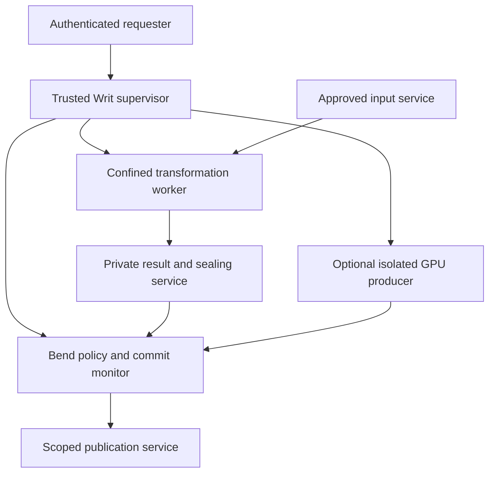

# One Writ policy model, three native hosts

**Decision:** Windows is the first product target. Genode remains Writ's reference
capability platform, and Linux is a native host target. All three require their
own native filesystem and enforcement evidence. A later kernel using
[Spaceghost/Drift](https://github.com/Spaceghost/drift) must satisfy the same host
contract. Writ's policy, verification, and state transitions remain authored in
Bend 2 on every target.

This document separates the implemented native public-canary contribution from
the broader host acceptance plan. The repository now has real Linux FUSE,
Windows WinFsp and native Genode filesystem bindings using the same Bend policy.
Linux and native Genode canary lanes pass. Windows mounted reads and revocation
pass, while its complete confinement lane remains failed. These bounded results
are recorded in the [native execution evidence](../contrib/native-hosts/VERIFICATION.md);
they do not qualify arbitrary applications, durable publication or a complete
protected-data host. A custom kernel remains future work.

The separate public writable desktop preview now has both
[Windows Cloud Files](../contrib/native-hosts/windows/cloud-files/README.md) and
[Linux FUSE](../contrib/native-hosts/linux/public-sync/README.md) bindings over
one Bend save monitor. Native parity and installation pass on Ubuntu and Fedora,
and the combined release requires Windows regression checks too. These
public-save results do not change
the protected-reader confinement qualifications below.

The [shared files-and-rules app](../contrib/native-hosts/drive/README.md) uses
the same Bend decisions and local browser controls on Linux and Windows, with
ordinary working files and S3-compatible storage. Its owner-approved managed
copies and provenance do not confine arbitrary desktop applications. Native
Cloud Files/FUSE placeholders for this multi-storage catalog remain unimplemented;
the existing Windows tray/folder-sync contribution stays a separate profile.

## Platform roles

| Target | Role | Native boundary to use | Current Writ evidence |
| --- | --- | --- | --- |
| Genode on Linux | Separate native C runtime bring-up and debugging | Genode sessions, capability-mediated IPC, restricted components; host bridges explicitly trusted | Generated Bend C runs as a component with the inventoried memory shim: the 782-check corpus and four examples match the Linux single-lane record, and the Writ channel serves and denies through Bend ([corpus](../verification/genode-corpus-base-linux.txt), [channel](../verification/genode-channel-base-linux.txt), [runtime rows](../verification/genode-runtime-rows-base-linux.md)); a fault terminates the component but init records nothing. The same component on x86_64 base-hw under QEMU TCG (emulated boot, not native hardware) passes the corpus and the channel runs, with a self-reported fault exit ([corpus](../verification/genode-corpus-base-hw.txt), [channel](../verification/genode-channel-base-hw.txt)); one lane, CPU only |
| Native Genode | Capability reference; Genode 26.08 x86_64/base-hw under QEMU | Protection domains, routed services, dataspaces, resource quotas, kernel-backed object capabilities | [Native pass](../contrib/native-hosts/genode/VERIFICATION.md): 782 core checks, 69 mount checks, 24 allocator assertions, 56 filesystem-session assertions and eight libc/VFS assertions; broader protected-host gates remain open |
| Direct Linux | Native Linux service deployment | Authenticated broker, a fixed confined reader, scoped descriptors, required kernel controls | [Native pass](../contrib/native-hosts/linux/verification/README.md): integrated 782-check core, real FUSE reads and actor denials, revocation, interpreter loss and broker-crash cleanup; complete host qualification pending |
| Native Windows | First filesystem product target | WinFsp, authenticated broker, LPAC worker profile, explicit handles and WFP | [Mounted I/O and revocation pass](../contrib/native-hosts/windows/VERIFICATION.md); direct byte-worker channel probes remain incomplete and the enclosing confinement lane fails |
| Future kernel with Drift | Own-kernel deployment after its protection mechanisms exist | Kernel capabilities, isolated drivers, IRQ/DMA/memory mediation, durable storage | Drift source review; no Writ kernel port |

Linux and Windows bindings invoke Bend-generated JavaScript through native Node.
Genode runs the same generated module inside a native QuickJS component. The
policy state remains private to that interpreter. The approved source boundary
is [contrib/native-hosts](../contrib/native-hosts/README.md): C/C++ OS interfaces,
resource/handle lifetimes, necessary runtime adaptation and a small invocation
harness, with an explicit source and trust inventory. These paths establish
native OS execution of generated Bend; they do not claim a general machine-code
Bend port to Windows or Genode.

The Windows byte worker cannot initialize the direct network, clipboard and
COM probes, so those outcomes receive no confinement credit. A separate
diagnostic process with `registryRead` and Win32k enabled receives no canary
bytes and has a different profile. Its successful checks do not replace the
byte worker's missing evidence. See the
[Windows record](../contrib/native-hosts/windows/VERIFICATION.md) for the exact
failed run and remaining product gates.

Genode supports multiple base kernels, and its documentation explicitly makes
security dependent on the selected implementation. Genode-on-Linux has a real
capability/seccomp design; it is not simply an unconfined mock. It nevertheless
retains the Linux kernel and any unrestricted hybrid services in its trusted
base. These are separate qualification profiles, not interchangeable security
claims. See [Genode integration](GENODE.md) and the upstream
[capability model](https://genode.org/documentation/genode-foundations/26.05/architecture/Capability-based_security.html)
and [base-linux security design](https://genode.org/documentation/release-notes/20.05#Capability-based_security_using_seccomp_on_Linux).

## What we learn from Genode

Reuse its object identity, protection domains, parent-mediated service routing,
and resource accounting. A Writ operation should be exposed through a native
session whose authority is already constrained by the component topology. Writ
then checks the exact plan, data origins, paired grants, labels, current consent,
budget, and sealed result before any publication.

That gives us two cooperating checks:

| Question | Mechanism |
| --- | --- |
| May this component invoke this service object? | The host's native capability or authenticated IPC boundary |
| May this exact derivation reach this destination under current terms? | The shared Bend Writ decision path |

Genode's session labels help parents route requests, but a client-chosen suffix
does not authenticate a person. Native capability selectors are local to a
protection domain and change when delegated. A selector, Linux descriptor number,
Windows handle value, or Drift DMA token is never a portable credential.
The detailed mapping and source references are in [GENODE.md](GENODE.md),
[HOST-PLATFORMS.md](HOST-PLATFORMS.md), and [DRIFT.md](DRIFT.md).

### Delegation needs an explicit meaning

Genode capabilities are delegable authority. An RPC endpoint identifies the
service object being invoked; its possession does not by itself establish the
original human or protection domain making the current request. A wrapper object
alone does not make that authority nondelegable.

Writ preserves its existing subject-bound contract. The host must establish the
requesting subject through an authenticated session mechanism and an enforced
delegation policy. Delegation preserves the exact plan and all origin terms;
rights and lifetime may narrow. A different subject or plan requires a newly
authorized binding. When the
host cannot establish the required identity or prevent an out-of-scope transfer,
the protected request is denied. It must not silently treat a later holder as
the original reader.

The proposed topology for transformation workers avoids that ambiguity: the
trusted supervisor retains the Writ commit session. A worker receives scoped inputs and a
private result channel, with no direct commit capability. Any allowed channel
that can carry capabilities is part of the confinement review.

## The shared host contract

Five primitive families connect platform mechanisms to the Bend library. These
requirements for complete hosts extend beyond the contribution's bounded
[mounted-view protocol](../contrib/native-hosts/PROTOCOL.md).

| Primitive family | Required behavior |
| --- | --- |
| Session binding | Authenticate the endpoint/subject, define delegation, bind host incarnation and resource generation, and reject stale or ambiguous mappings |
| Worker domain | Establish the complete input inventory, quotas, and permitted effects before plaintext arrives; mediate all other output channels |
| Artifact exchange | Transfer scoped inputs and an output that cannot be changed by any remaining writer; bind the exact artifact and execution identity |
| Publication | Recheck current authority through the Bend facade and durably apply the approved state and exact artifact with replay protection |
| Revocation and teardown | Stop new admission, reconcile in-flight work, invalidate affected handles, quiesce workers/devices, and reject stale completions |

The native adapter keeps real capabilities, descriptors, handles, and memory
objects local. Bend sees validated records derived from those resources. Public
Bend constructors remain descriptive values, not proof that a native check took
place. A wire peer cannot supply the monitor's Context, bindings, ledger, or
authenticated subject.

If a portable reference must cross a host boundary, it is a request for a newly
authenticated, scoped grant. Serialization does not transfer native authority.
Any authoritative encoding must be versioned, canonical, bounded, and explicit
about integer widths and unknown variants; JSON is not the core fact format.

The library model of this contract is `HostWire.bend`, `HostIdentity.bend`,
`HostPrimitives.bend` (with `HostPublication.bend` for families 3 to 5), and
`HostConformanceVectors.bend`, tested in Bend on two synthetic adapters; native
qualification of every target is pending in section 2 of the [portable host
contract tasks](../openspec/changes/add-portable-host-contract/tasks.md).

## Reference component topology

This is the proposed topology for protected transformations. The canary mounts do not
implement this complete pipeline; Genode's current diagnostic clients also have
explicit log capabilities.
Spaceghost selected the monitor one level above clients in a nested init as
the Genode reference; the [nested routing fixture plan](../openspec/changes/add-genode-host/nested-routing-fixture-plan.md)
records the proposed public experiment and its unverified boundary. Existing
channel evidence uses a same-init topology.

Edges denote permitted interactions, not unrestricted bidirectional service
access. The worker has no route to the publication service or monitor memory.
Output-dependent errors, status, logs, metadata, and timing exposed by the
declared interface remain policy sinks. Hardware covert-channel guarantees are
limited to the explicitly validated threat model.

The GPU producer uses a copied authoritative snapshot and returns a proposal.
It cannot modify the monitor's original graph or authority state. If the backend
cannot isolate device/DMA access, protected work stays on the CPU or is refused
when GPU execution is mandatory. Genode graphics support alone does not establish
a working Bend compute backend.

### A concrete example

An incident-report worker receives the approved report version and can emit its
summary only into private result storage. Its attempt to send a ROT13 string to
a socket or log is blocked by the host's effect boundary. The output still carries
the report's origin terms, so Writ also rejects publication to a public bucket.

If an owner revokes approval while the worker is running, the final Bend gate
denies publication. The supervisor contains or terminates the worker and prevents
its private output from becoming externally visible. Revocation stops future
authorized use; it cannot recall plaintext already copied into an independently
authorized reader's memory.

## Portability has separate milestones

| Milestone | Evidence required |
| --- | --- |
| Library executes | Pinned Bend toolchain compiles and runs the same tests on that target |
| Adapter speaks the protocol | Native calls establish the intended typed session and exact request mapping |
| Protected execution works | Real malicious-worker attempts against every configured egress channel fail, while the approved path succeeds |
| Durable operation works | Crash/replay/revocation tests preserve authority, funds, metadata, and exactly the approved publication |
| Accelerator works | The actual compute backend runs, remains isolated as required, and matches verified CPU results |

The pinned Bend 2.0.39 installation supplies Linux/macOS native execution. The
Windows and Genode canary bindings use the generated-JavaScript paths described
above; general machine-code runtime ports remain separate work. WSL is Linux
execution evidence. The available Linux release also does not establish
musl/Alpine compatibility. See [installation](INSTALL.md) and the separately
recorded [runtime surface](BEND-RUNTIME.md).

Keep policy and verification in Bend. Adapt allocation, threads, clocks, entropy,
IPC, and other necessary runtime primitives through a narrow platform boundary.
The approved C/C++ bindings and JavaScript harness under `contrib/native-hosts/`
have that limited responsibility. They must preserve the authoritative Bend
state and decisions; the per-platform source/trust inventories identify their
native authority and dependencies.

## Drift and the future kernel

Drift supplies portable driver machinery; it is not the kernel authority layer.
Its register, DMA, interrupt-adjacent, and storage interfaces must be backed by
resources allocated and constrained by the future kernel. Device access never
implicitly grants authority over Writ's monitor or protected data.

The preferred reuse experiment is a Genode base adaptation over the new kernel,
with Drift-backed drivers isolated behind Genode services. That preserves the
Genode-facing Writ component architecture if the kernel can meet Genode's base
requirements. A direct Writ adapter is a second option, requiring independent
conformance evidence; Drift alone does not satisfy either path.

## Build order and specifications

Keep one common host contract and prioritize the Windows filesystem/broker and
confined-reader product slice. Extend the passing Linux FUSE and native Genode
filesystem-session contributions against the same Bend decisions, while closing
the Windows byte worker's remaining confinement gates. Genode-on-Linux remains
a separate runtime/session bring-up path; the base-hw canary's passing execution
does not qualify that runtime or the complete protected host. See the
[product plan](WRITFS-PRODUCT.md).
The [WritFS native storage backend](../writfs/README.md) is one such isolated
Linux primitive: it creates private Btrfs snapshots and ZFS filesystem/zvol
clones using the same Bend commit gate. Its native storage evidence does not
qualify the complete Linux host or complete any confinement, durable publication,
authentication, or revocation milestone.
The later kernel follows after its memory, capability, IPC, and device mechanisms
have their own evidence.

The [roadmap](../openspec/ROADMAP.md) tracks the common contract and four host
changes, plus a runtime and unikernel lane: the
[Bend runtime host profile](../openspec/changes/archive/2026-11-04-add-bend-runtime-host-profile/proposal.md)
every port must satisfy ([inspected surface](BEND-RUNTIME.md)), an
[immutable unikernel appliance](../openspec/changes/add-unikernel-appliance-host/proposal.md)
for the monitor alone, a
[library-unikernel runtime](../openspec/changes/add-unikernel-library-runtime/proposal.md)
that links the monitor natively into an existing unikernel
([candidate survey](UNIKERNELS.md)), and a
[freestanding runtime](../openspec/changes/add-freestanding-bend-runtime/proposal.md)
for the later kernel. A unikernel's single address space hosts the monitor; it
is not a worker confinement boundary. For Genode, the
[Bend component](../openspec/changes/archive/2026-11-04-add-genode-bend-component/proposal.md) and
[capability adoption](../openspec/changes/archive/2026-11-04-add-genode-capability-adoption/proposal.md)
changes supply the runtime, effects, and binding model the reference host's
tasks assume. POSIX remains the first file-style interface, followed by S3. This
interface ordering does not make a Linux character device the foundation of the
Genode or Windows ports. Each adapter must reach the same Bend authorization path.

No platform becomes a protected Writ target merely because these specifications
validate. Each claimed profile records its exact OS/kernel, runtime, configuration,
driver dependencies, conformance results, and known limits.
