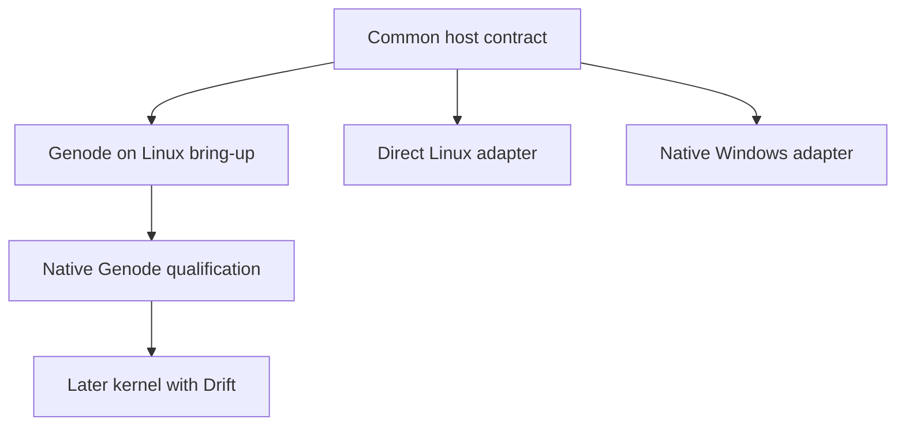
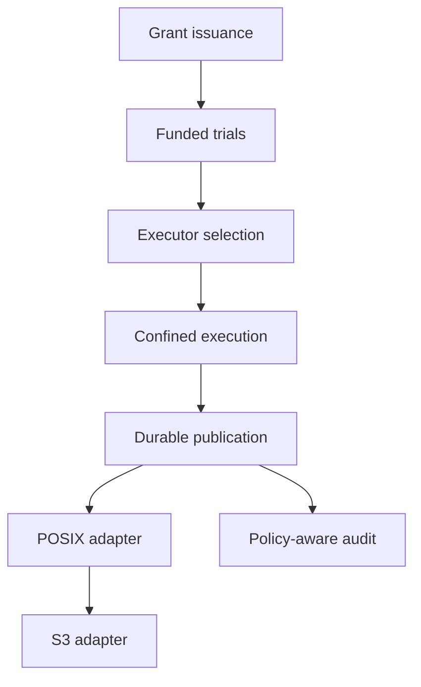

# Pending implementation

Every pending change below is proposed. Its implementation tasks are unchecked. Existing
Bend decisions and protocol models do not make the missing host service complete.

The separately implemented [rclone contribution](../contrib/rclone/README.md)
provides a bounded memory-only client integration exercise. Its
[reference contract](specs/rclone-contrib-remote/spec.md) and
[evidence](../contrib/rclone/VERIFICATION.md) leave all production host,
authenticated issuer, confinement, and durable-publication work below pending.

**Genode is the reference native capability platform.** The shared Bend policy
core will also support direct Linux, native Windows, and a later kernel using
Drift. Host qualification and file-style API compatibility are separate work.
See the [platform architecture](../docs/PLATFORMS.md).

## Native host foundation

| Lane | Change | Required evidence |
| --- | --- | --- |
| Shared contract | [Portable host contract](changes/add-portable-host-contract/proposal.md) | Exact subject/delegation binding, scoped resources, immutable artifacts, current commit, shared vectors, and native probes |
| Reference | [Genode host](changes/add-genode-host/proposal.md) | Real Bend runtime/component bring-up, session routing, confined report-to-summary execution, and a separately qualified native base |
| Linux | [Direct Linux host](changes/add-linux-host/proposal.md) | Required kernel controls, authenticated broker, restricted descriptors/processes, and actual escape-path tests |
| Windows | [Native Windows host](changes/add-windows-host/proposal.md) | Validated runtime/ABI, LPAC/AppContainer profile, authenticated IPC, restricted handles/process tree, and native probes |
| Later kernel | [Drift-backed kernel host](changes/add-drift-kernel-host/proposal.md) | Kernel authority/isolation plus scoped driver resources; reuse Genode over a new base where feasible |

Genode-on-Linux is the first runtime/session bring-up lane. Its restricted
components and unrestricted host bridges must be inventoried; it is not equivalent
to native Genode qualification. The first native reference is pinned Genode 26.08
x86_64/base-hw under QEMU; hardware deployment needs its own evidence. Direct
Linux and Windows can develop against the common contract
without depending on a Genode binary installation.

Every native lane also needs the feature-level issuance, confinement, and durable
publication dependencies below before handling protected data. Passing a model
test, booting a component, or observing one denied syscall completes none of those
combined enforcement gates by itself.

## Feature dependencies

| Order | Change | Capability and exit evidence |
| --- | --- | --- |
| 1 | [Authenticated grant issuance](changes/add-authenticated-grant-issuance/proposal.md) | Authenticate source and destination issuers; no effective read grant without its exact current write approval |
| 2 | [Metered sample execution](changes/add-metered-sample-execution/proposal.md) | Reserve trial compute before protected sampling; bounded settlement and refunds |
| 3 | [Executor rendezvous](changes/add-executor-rendezvous/proposal.md) | Select an eligible provider and bind its identity, candidate, evidence, and reader terms |
| 4 | [Confined transformations](changes/add-confined-transform-execution/proposal.md) | Account for all observable inputs and mediate outputs; seal actual result bytes |
| 5 | [Durable publication](changes/add-durable-publication/proposal.md) | Crash-safe authorization and idempotent publication with inseparable inherited policy |
| 6 | [Capability POSIX adapter](changes/add-capability-posix-adapter/proposal.md) | Native device operations preserve capability scope and deny bypass routes |
| 7 | [S3 adapter](changes/add-s3-adapter/proposal.md) | Declared S3 subset follows the same authority path after POSIX |
| Parallel | [External planner adapters](changes/add-external-planner-adapters/proposal.md) | AI/Trealla propose bounded untrusted requests; Bend retains authorization |
| After durable state | [Policy-aware audit](changes/add-policy-aware-audit/proposal.md) | Scoped, durable events and queries without a secondary exfiltration route |
| Hardware lane | [Physical GPU validation](changes/validate-physical-gpu-execution/proposal.md) | Device execution evidence, exact result checks, and complete-path measurements |

These are implementation dependencies, not a claim that an intermediate stage is
safe to deploy alone. In particular, issuance needs durable authoritative storage
before production, even though its pure transition logic can be implemented first.

## Integration path

Planner adapters may develop against authenticated request interfaces in parallel.
GPU validation can also proceed independently when suitable hardware is available.
Neither path grants authority to bypass the integration chain.

## Proposed defaults

The provider-selection change proposes the lowest approved total quote among
eligible offers, with canonical provider then offer identity breaking ties. This is a
reviewable default, not an implemented selection algorithm or an instruction to
prefer price over source-owner restrictions.

The POSIX change proposes a Linux character-device control interface and a
capability-bound logical namespace. The transport and host isolation mechanism
are explicit dependencies. The published baseline does not contain a kernel
driver, filesystem mount, or foreign-language runtime.

POSIX remains the first file-style interface, followed by S3. A Linux character
device is one host adapter, not a required substrate for the Genode or Windows
targets. Host ports must preserve the common subject, delegation, exact-plan,
and publication semantics before exposing compatibility interfaces.

Each change records migration and rollback behavior. Rollback never restores
consumed receipts or authority epochs, and never falls back to an unchecked
output path.
