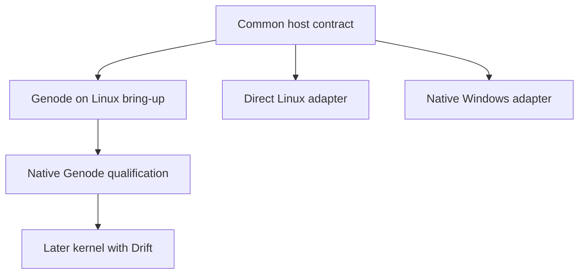
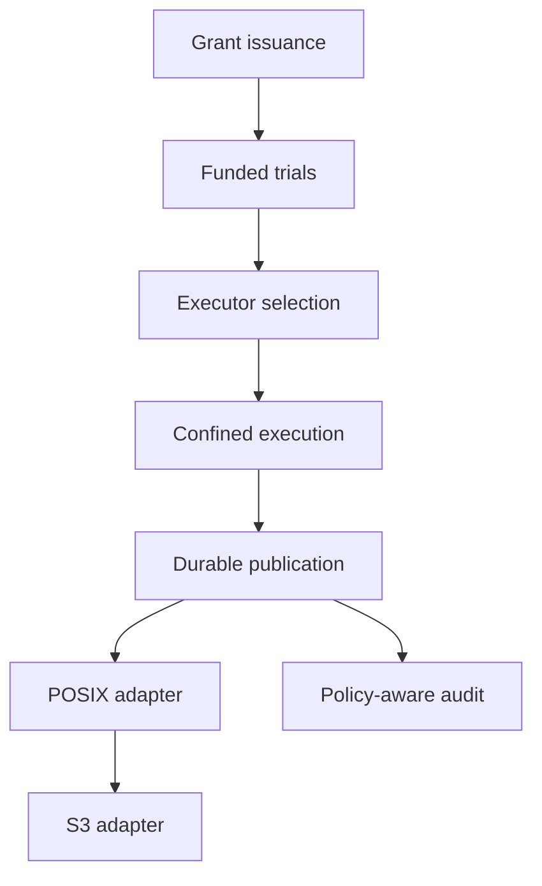

# Pending implementation

Every pending change below remains incomplete. Its task list records bounded
implementation evidence already obtained. Models and partial native probes do
not qualify the complete host service.

The separately implemented [rclone contribution](../contrib/rclone/README.md)
provides a bounded memory-only client integration exercise. Its
[reference contract](specs/rclone-contrib-remote/spec.md) and
[evidence](../contrib/rclone/VERIFICATION.md) leave all production host,
authenticated issuer, confinement, and durable-publication work below pending.

[WritFS native staging](../writfs/README.md) adds a separate native storage
primitive: private read-only Btrfs snapshots and ZFS filesystem/zvol clones.
Its bounded native adapter does not complete the broader Linux host, POSIX
presentation, authenticated issuer, or durable-publication requirements below.

The [native canary frontends](../contrib/native-hosts/README.md) add WinFsp,
Linux FUSE and native Genode File_system/VFS for one immutable public object.
Their [execution record](../contrib/native-hosts/VERIFICATION.md) leaves broader
host, issuer, namespace and durable-audit/publication tasks below open. Windows
mounted access passes while its full confinement gate remains failed. Generated
JavaScript execution is separate from the machine-code runtime proposals.

**Windows is the first product target; Genode is the reference native capability
platform.** The shared Bend policy core also targets native Linux and a later
kernel using Drift. Host qualification and file-style API compatibility are separate work.
See the [platform architecture](../docs/PLATFORMS.md).

## Native host foundation

| Lane | Change | Required evidence |
| --- | --- | --- |
| Shared contract | [Portable host contract](changes/add-portable-host-contract/proposal.md) | Exact subject/delegation binding, scoped resources, immutable artifacts, current commit, shared vectors, and native probes |
| Reference | [Genode host](changes/add-genode-host/proposal.md) | Real Bend runtime/component bring-up, session routing, confined report-to-summary execution, and a separately qualified native base |
| Linux | [Direct Linux host](changes/add-linux-host/proposal.md) | Required kernel controls, authenticated broker, restricted descriptors/processes, and actual escape-path tests |
| Windows | [Native Windows host](changes/add-windows-host/proposal.md) | Validated runtime/ABI, LPAC/AppContainer profile, authenticated IPC, restricted handles/process tree, and native probes |
| Later kernel | [Drift-backed kernel host](changes/add-drift-kernel-host/proposal.md) | Kernel authority/isolation plus scoped driver resources; reuse Genode over a new base where feasible |

The Windows filesystem/broker and confined-reader slice is the first product
lane; see the [product plan](../docs/WRITFS-PRODUCT.md). Genode-on-Linux remains a
runtime/session bring-up lane. Its restricted components and unrestricted host
bridges must be inventoried; it is not equivalent to native Genode qualification.
The first native reference is pinned Genode 26.08
x86_64/base-hw under QEMU; hardware deployment needs its own evidence. Direct
Linux and Windows can develop against the common contract
without depending on a Genode binary installation.

Every native lane also needs the feature-level issuance, confinement, and durable
publication dependencies below before handling protected data. Passing a model
test, booting a component, or observing one denied syscall completes none of those
combined enforcement gates by itself.

### Runtime and unikernel lane

Each native lane says "port the Bend runtime" in its tasks. These three changes
make that prerequisite concrete and add the immutable-image deployment shape from
the project's founding discussion. The inspected runtime surface for Bend 2.0.39
is in [docs/BEND-RUNTIME.md](../docs/BEND-RUNTIME.md).

| Order | Change | Required evidence |
| --- | --- | --- |
| 1 | [Bend runtime host profile](changes/add-bend-runtime-host-profile/proposal.md) | Per-version host inventory, monitor allowlists, a binary check, and single-lane parity on each host |
| 2 | [Unikernel appliance host](changes/add-unikernel-appliance-host/proposal.md) | Corpus booted inside a pinned Linux-compatible unikernel image, one authenticated ingress, external state, and a timed rebuild drill |
| 3 | [Library-unikernel Bend runtime](changes/add-unikernel-library-runtime/proposal.md) | Monitor natively linked into a library unikernel chosen by an executed matrix ([survey](../docs/UNIKERNELS.md)), effects bound to kernel primitives, parity in three environments |
| 4 | [Freestanding Bend runtime](changes/add-freestanding-bend-runtime/proposal.md) | Unchanged evaluator over a reviewed no-libc host layer on a 64-bit kernel variant, serial-captured parity with the Linux single-lane record |

The appliance hosts the monitor only; its single address space is never a worker
boundary. The library runtime is the end state of "leverage an existing
unikernel and make the Bend runtime fit it"; the appliance is its compat-mode
first boot. The freestanding runtime feeds the Drift kernel host's runtime task
and supplies none of that host's isolation, capability, or publication evidence.

### Genode runtime and binding lane

Two changes make the Genode reference host's runtime and ingress tasks
concrete. They can proceed in parallel: one is a Genode build, the other is pure
Bend.

| Change | Required evidence |
| --- | --- |
| [Bend runtime as a Genode component](changes/add-genode-bend-component/proposal.md) | Generated C compiled in the Genode build on `base-linux` then `base-hw`; per-row runtime outcomes; Bend-authored effects over LOG, Timer, and a Writ session; one inventoried `extern "C"` shim with no policy |
| [Genode capability adoption](changes/archive/2026-11-04-add-genode-capability-adoption/proposal.md) (archived 2026-11-04; baseline [genode-capability-adoption](specs/genode-capability-adoption/spec.md)) | A Bend host-binding model composed with `Frontend`: generations, routes, delegation edges, quotas; adopted and rejected Genode semantics as tests, laws, and replayable vectors |

Neither completes the Genode host's confinement, sealing, or revocation tasks.

## Feature dependencies

| Order | Change | Capability and exit evidence |
| --- | --- | --- |
| 1 | [Authenticated grant issuance](changes/add-authenticated-grant-issuance/proposal.md) | Authenticate source and destination issuers; no effective read grant without its exact current write approval |
| 2 | [Metered sample execution](changes/add-metered-sample-execution/proposal.md) | Reserve trial compute before protected sampling; bounded settlement and refunds |
| 3 | [Executor rendezvous](changes/add-executor-rendezvous/proposal.md) | Select an eligible provider and bind its identity, candidate, evidence, and reader terms |
| 4 | [Confined transformations](changes/add-confined-transform-execution/proposal.md) | Account for all observable inputs and mediate outputs; seal actual result bytes |
| 5 | [Durable publication](changes/add-durable-publication/proposal.md) | Crash-safe authorization and idempotent publication with inseparable inherited policy |
| 6 | [Capability POSIX adapter](changes/add-capability-posix-adapter/proposal.md) | Native device operations preserve capability scope and deny bypass routes |
| 7 | [S3 adapter](changes/add-s3-adapter/proposal.md) | Declared S3 subset follows the same authority path after POSIX |
| Parallel | [External planner adapters](changes/add-external-planner-adapters/proposal.md) | AI/Trealla propose bounded untrusted requests; Bend retains authorization |
| After durable state | [Policy-aware audit](changes/add-policy-aware-audit/proposal.md) | Scoped, durable events and queries without a secondary exfiltration route |
| Hardware lane | [Physical GPU validation](changes/validate-physical-gpu-execution/proposal.md) | Device execution evidence, exact result checks, and complete-path measurements |

These are implementation dependencies, not a claim that an intermediate stage is
safe to deploy alone. In particular, issuance needs durable authoritative storage
before production, even though its pure transition logic can be implemented first.

## Integration path

Planner adapters may develop against authenticated request interfaces in parallel.
GPU validation can also proceed independently when suitable hardware is available.
Neither path grants authority to bypass the integration chain.

## Data views and cooperative operations

These seven proposed changes extend the feature chain. The
[feature guide](../docs/FEATURES.md) explains the user-facing behavior; the
[acceptance index](FEATURE-ACCEPTANCE.md) lists the cross-feature checks and
unverified evidence. All policy and verification implementation remains Bend.

| Change | Scope | Depends on |
| --- | --- | --- |
| [Addressable views](changes/add-addressable-views/proposal.md) | Freeze inputs behind a named computation; explicitly materialize and reconcile its result | Issuance, confinement, durable publication |
| [Locality-aware execution](changes/add-locality-aware-execution/proposal.md) | Enforce source/executor placement constraints and declared movement costs | Executor rendezvous, portable host contract |
| [Controlled disclosure](changes/add-controlled-disclosure/proposal.md) | A versioned, affected-owner-authorized release of exact sealed output | Issuance, confinement, durable publication |
| [Origin transform stages](changes/add-origin-transform-stages/proposal.md) | Pinned preparation, requested computation, and release processing | Confinement, durable publication, controlled disclosure |
| [WritFS namespace](changes/add-writfs-namespace/proposal.md) | Session-scoped files, views, job state, receipts, and explicit controls | Host contract, issuance, durable publication, addressable views |
| [Scoped private matching](changes/add-scoped-private-matching/proposal.md) | Approved import/corpus comparisons with bounded result disclosure | Issuance, confinement, controlled disclosure, durable publication |
| [Cooperative retirement](changes/add-cooperative-retirement/proposal.md) | Scoped revocation, disposal coordination, and truthful participant receipts | Host contract, issuance, durable publication |

WritFS initially requires explicit materialization. Browsing a namespace never
starts work. The first matching profile is a mutually approved confined service
with exact equality; cryptographic input privacy and semantic similarity need
separate qualification. A disclosure grant changes only its specified
confidentiality policy; original provenance and all other obligations remain.

The common native boundary stays authoritative behind every presentation.
WritFS does not choose FUSE, an on-disk format, or a storage engine. Direct Linux
file compatibility builds on its native adapter; Genode and Windows use their
own qualified bindings. Retirement and matching do not depend on a filesystem
mount and do not acquire authority from a path.

## Proposed defaults

The provider-selection change proposes the lowest approved total quote among
eligible offers, with canonical provider then offer identity breaking ties. This is a
reviewable default, not an implemented selection algorithm or an instruction to
prefer price over source-owner restrictions.

The locality change retains that ranking after filtering required residency and
executor constraints. Approved total quotes include declared movement costs.
A new preference ordering needs a coordinated, versioned rendezvous change;
it cannot silently reorder an already approved plan.

The POSIX change proposes a Linux character-device control interface and a
capability-bound logical namespace. The transport and host isolation mechanism
are explicit dependencies. The published baseline does not contain a kernel
driver, filesystem mount, or foreign-language runtime.

In the POSIX/S3 compatibility lane, S3 follows the POSIX adapter. The filesystem
product targets Windows first. A Linux character device is one host adapter,
not a required substrate for the Genode or Windows targets. Host ports must
preserve the common subject, delegation, exact-plan, and publication semantics
before exposing compatibility interfaces.

Each change records migration and rollback behavior. Rollback never restores
consumed receipts or authority epochs, and never falls back to an unchecked
output path.
