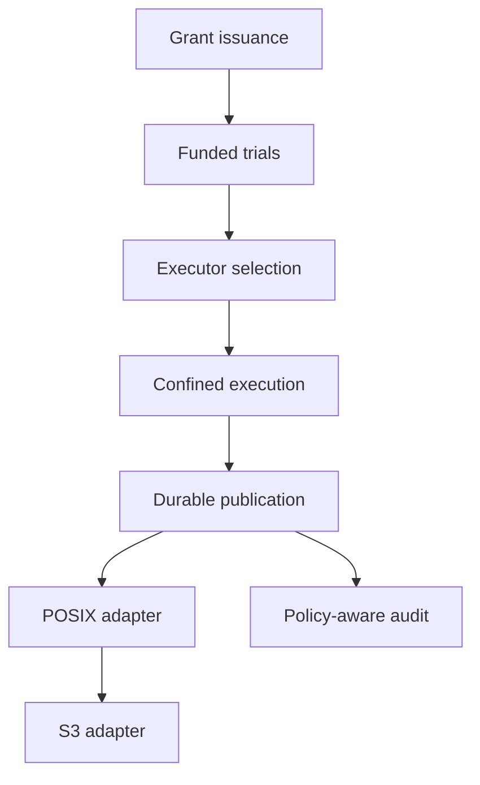

# Pending implementation

Every change below is proposed. Its implementation tasks are unchecked. Existing
Bend decisions and protocol models do not make the missing host service complete.

| Order | Change | Capability and exit evidence |
| --- | --- | --- |
| 1 | [Authenticated grant issuance](changes/add-authenticated-grant-issuance/proposal.md) | Authenticate source and destination issuers; no effective read grant without its exact current write approval |
| 2 | [Metered sample execution](changes/add-metered-sample-execution/proposal.md) | Reserve trial compute before protected sampling; bounded settlement and refunds |
| 3 | [Executor rendezvous](changes/add-executor-rendezvous/proposal.md) | Select an eligible provider and bind its identity, candidate, evidence, and reader terms |
| 4 | [Confined transformations](changes/add-confined-transform-execution/proposal.md) | Account for all observable inputs and mediate outputs; seal actual result bytes |
| 5 | [Durable publication](changes/add-durable-publication/proposal.md) | Crash-safe authorization and idempotent publication with inseparable inherited policy |
| 6 | [Capability POSIX adapter](changes/add-capability-posix-adapter/proposal.md) | Native device operations preserve capability scope and deny bypass routes |
| 7 | [S3 adapter](changes/add-s3-adapter/proposal.md) | Declared S3 subset follows the same authority path after POSIX |
| Parallel | [External planner adapters](changes/add-external-planner-adapters/proposal.md) | AI/Trealla propose bounded untrusted requests; Bend retains authorization |
| After durable state | [Policy-aware audit](changes/add-policy-aware-audit/proposal.md) | Scoped, durable events and queries without a secondary exfiltration route |
| Hardware lane | [Physical GPU validation](changes/validate-physical-gpu-execution/proposal.md) | Device execution evidence, exact result checks, and complete-path measurements |

These are implementation dependencies, not a claim that an intermediate stage is
safe to deploy alone. In particular, issuance needs durable authoritative storage
before production, even though its pure transition logic can be implemented first.

## Integration path

Planner adapters may develop against authenticated request interfaces in parallel.
GPU validation can also proceed independently when suitable hardware is available.
Neither path grants authority to bypass the integration chain.

## Proposed defaults

The provider-selection change proposes the lowest approved total quote among
eligible offers, with canonical provider then offer identity breaking ties. This is a
reviewable default, not an implemented selection algorithm or an instruction to
prefer price over source-owner restrictions.

The POSIX change proposes a Linux character-device control interface and a
capability-bound logical namespace. The transport and host isolation mechanism
are explicit dependencies. The published baseline does not contain a kernel
driver, filesystem mount, or foreign-language runtime.

Each change records migration and rollback behavior. Rollback never restores
consumed receipts or authority epochs, and never falls back to an unchecked
output path.
