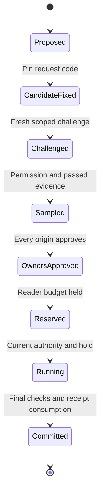
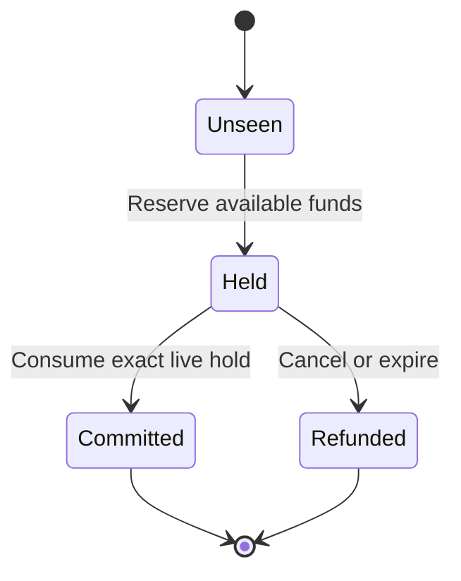

# Existing state machines

These diagrams describe the current pure model. Native process lifecycle,
durability, provider selection, and trial billing belong to pending changes.

## Transformation negotiation

Every guarded transition checks its expected revision and live request.
A rejected transition returns the supplied state unchanged. Pinning fixes an
identity; admission checks operation approval. Sample success does not release
data or remove restrictions. The protected sample needs permission before it runs.

Reservation follows sampling in the current model. Sample compute is therefore
not automatically funded by the main execution hold. There is no provider
identity or candidate-ranking state in this lifecycle.

See [negotiation](specs/transformation-negotiation/spec.md) and
[commit](specs/commit-backplane/spec.md).

## Receipt lifecycle

This is the observable lifecycle of a receipt, not a claim that the ledger stores
each state as a separate enum constructor.

A receipt remains seen after refund or commit. It cannot be reused to reserve
again. A failed transition leaves the original ledger unchanged. Revisions
serialize only against the state supplied to the function; the host must provide
current durable state.

See [reservation ledger](specs/reservation-ledger/spec.md).

## Capability handles

| Operation | Model effect |
| --- | --- |
| Mount | Creates a subject/token/plan-bound mount handle using current registry authority |
| Open | Allocates a new descriptor from a valid mount; the mount is not replaced |
| Duplicate | Allocates a new descriptor with the original authority limits |
| Attenuate | Reduces rights on the selected handle; it cannot restore removed rights |
| Close | Marks the handle closed; its identity is not recycled |

Operational resolution requires a descriptor, current authority, the exact stored
plan, requested rights, and full paired transfer admission. A mount handle itself
does not authorize protected reads. Revocation is checked on use.

See [capability frontend](specs/capability-frontend/spec.md).
