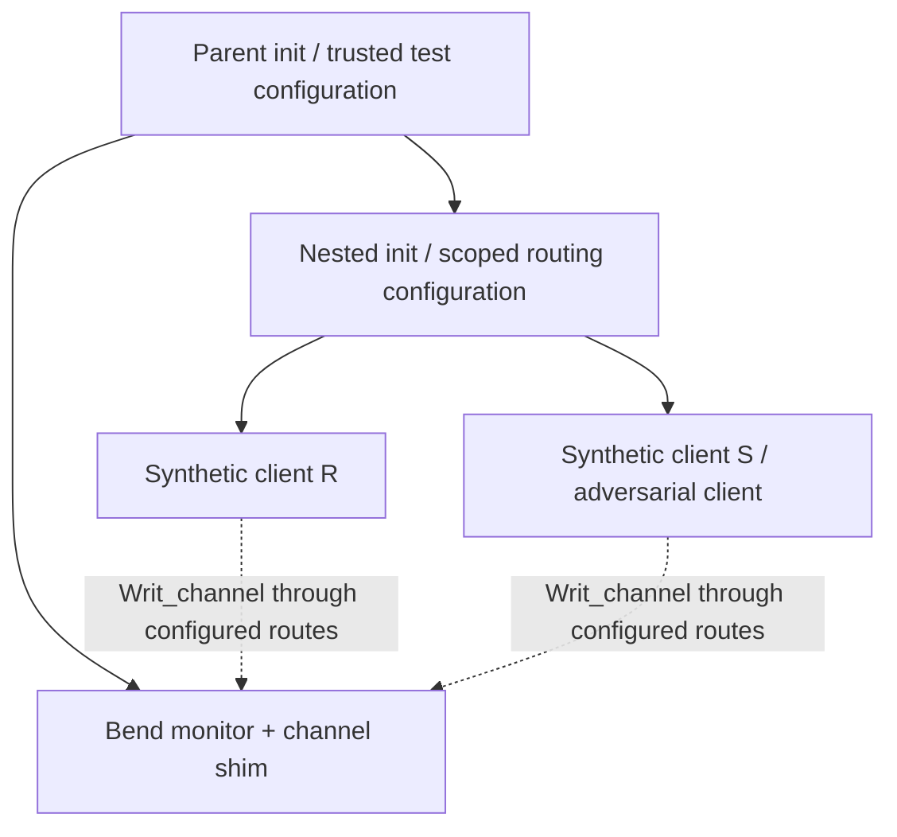

# Nested Genode routing: public-fixture design

A synthetic reader R starts beneath a nested `init` and requests the existing
`Writ_channel` service. The reference monitor is one level above that nested
`init`; it must receive a route-derived identity that cannot be selected by R's
request body or chosen label suffix. A second synthetic client tries to select
R's identity. A public-fixture run should show the actual label and route at
each hop, a permitted R decision and the adversary's refusal, or record the
configuration or implementation failure that prevents the observation.

**Current gap:** the repository's recorded channel scenarios place the monitor
and clients under the same `init`. No nested-monitor configuration or result is
established by those runs. This is a design and fixture plan, not a runnable
profile, an authenticated-actor design, or a protected-host qualification. No
nested fixture has been implemented or run as part of this document.
A subsequent [pinned-source configuration proposal](nested-routing-source-review.md)
traces the expected two-hop label and identifies the current equal-score policy
tie gap; its predictions have not been observed in a nested run.

## Decision and source basis

The [q18 record](../../../docs/superpowers/records/questions/q18.answers.jsonl)
contains a response timestamped `2026-11-05T17:26:29Z`, submitted by `josh`
with `from: spaceghost`, selecting `monitor: nested-init`: the monitor is one
level up and clients are under a nested `init`. This chooses a reference layout;
it does not say that the layout is implemented or validated. The same response
has no veto fields for q18 item 7 and no selections for items 8–10. This plan
neither infers those answers nor changes an existing authority law. The
[recovered-question record](../../../docs/superpowers/records/spaceghost-questions.md)
explains the answer's provenance and timestamp ordering.

The repository source examined for this plan is commit
`c7cd174a5e8eab0e1f7a6bbac1df9df66c99401a`. Historical channel evidence used
Bend 2.0.39 and Genode 26.08 commit
`d18ee9e917200b059549e21f2dd9a55bfe61a0eb`; the recorded toolchain, framework
source and binary identities are in the [Genode pins](../../../verification/genode-pins.txt)
and the two channel records below. A future fixture must verify and record its
own exact source and toolchain identities; these historical pins are a starting
point, not proof that a new build used them.

| Source at the examined commit | SHA-256 |
| --- | --- |
| [Shared same-init channel runner](../../../scripts/genode/writ_bend_monitor/writ_bend_monitor.tcl) | `8d41ac09280f8cd93dc34969f14de3d4a1352d02000a34a37c221bd404b5943c` |
| [Base run setup](../../../scripts/genode/writ_bend.tcl) | `c15e76294042370865e5e9fffa4d2c63bdf5ad479351ebdd6be6191a01773e9a` |
| [Channel shim](../../../hosts/genode/shim/writ_mem.cc) | `9d9d32d2402bd947c96a4632ae945c6825d1291a3ce97e5ac45b7d0349f71b5d` |
| [Channel record and route description](../../../hosts/genode/effects/Channel.md) | `9fd0bb5193816cf4a9a7a2b6f8091b54909a55bcd279d5218ca67d943f0ab6b7` |
| [Bend monitor](../../../hosts/genode/monitor/Monitor.bend) | `d2b9c05ed9274fa1ca5d502f2d0afc951a47594b20a34c4bbd3db6336465d9e1` |
| [base-linux channel record](../../../verification/genode-channel-base-linux.txt) | `5f8156b2dd28772ca7bab40a777bda879755cf07e60b8cb488d4258bd985fb01` |
| [base-hw channel record](../../../verification/genode-channel-base-hw.txt) | `4f5dda6ed01e7e05e3095b2ebbd08acb77333dd125b975264c586a150ff48a4f` |
| [Recovered q18 answer and notes](../../../docs/superpowers/records/questions/q18.answers.jsonl) | `4f2ff8f44b0180dc273b325e350396c72bec5d975c8dbcdc09ece58bf5c48e90` |

## Existing evidence and boundary

The same-init runner starts `writ_bend_monitor` and clients as sibling children;
each client's `Writ_channel` route targets that monitor. The configuration
maps parent-prefixed client labels to synthetic subject words, while the request
body's claimed subject is untrusted. The runner also has an `any-service`
fallback to parent or another child; that public test configuration is not an
inventory of allowed protected-worker effects. The [channel description](../../../hosts/genode/effects/Channel.md)
and [Genode guide](../../../docs/GENODE.md) describe the descriptor binding,
synthetic Scenario state, fixed transport refusal, and recorded limitations.

The existing runs include R's accepted request, R's body claiming S and naming
S's session, S's routed request, malformed frames, liveness, queue and closed
client cases. They execute the existing Bend decision path; the resulting
write intent is descriptive and does not publish data. The base-linux record
is Genode hosted on Linux, not native Genode kernel evidence. The base-hw
record is x86_64 QEMU TCG emulation, not physical hardware or evidence for
other kernels. Neither is a nested-init run or an authenticated issuer.
The shim uses the framework's matching policy, rejects a default-only,
suffix-only, missing or zero-subject match, and permits a matching
`label_prefix` plus `label_suffix` policy to select a subject within that
prefix. Thus a suffix is not parent-authenticated merely because a trusted
prefix is also present. The nested label spelling and matching result are not
established by the same-init evidence.

The monitor has finite shared fuel and no configured supervisor restart after
exhaustion; the channel documentation also limits conclusions about whether a
reply signal can block in cases not tested. Those limits carry forward.

## Proposed fixture topology and inventory

The diagram states the intended component placement only. It does **not** claim
that Genode forwards a particular label, that the nested `init` authenticates
an actor, or that possessing a channel identifies the original human. Before
implementing the fixture, review the pinned Genode route and session-policy
sources and record where each hop constructs, prefixes, forwards, rewrites or
matches a label. Configure the monitor's policies only after the actual
parent-imposed prefix and the untrusted suffix boundary are established. Log
the full observable session label at each available trusted observation point;
if a hop cannot be observed, record the gap rather than inferring its value.

| Component or resource | Fixture obligation and open question |
| --- | --- |
| Parent init | Start the monitor and nested init as siblings; explicitly route their required services. Record the parent's policy/configuration and which config/ROM can be altered by which component. No blanket route should be presented as confinement. |
| Nested init | Supply a dedicated, recorded child configuration for the public clients; enumerate its parent services, child services, aliases, route rules and accessible configuration. Determine which parts of each label the nested init can influence before mapping subjects. |
| Monitor and channel | Keep the existing Bend decision and shim boundary. Route `Writ_channel` from the nested clients through the configured parents to the upper monitor; confirm actual request label, policy match, channel lifetime and close behavior. A route subject is a synthetic input, not an authenticated person. |
| Parent services | Inventory and justify LOG, PD, CPU, ROM, RM, Timer and any other startup/runtime dependencies for each component. Test-only logs may carry only public fixture values. Remove or explicitly list broad `any-service` routes; their presence prevents a confinement claim. |
| Data and capability paths | Identify every initial, inherited, requested, returned or delegated capability, including request/result dataspaces, signals, diagnostic routes and any route to publication. No test client receives a general commit or release endpoint. A received or delegated capability alone does not identify its current holder as its original subject. |
| Quotas and lifetime | Record parent, nested init, monitor and per-client RAM/capability donations, service session upgrades, execution fuel, timeout and teardown/restart configuration. Exercise shortage and denial without relying on a later retry to create authority. |

For comparison, the existing same-init script gives the monitor `256M` RAM and
`1000` caps, and each synthetic client `2M` RAM and `200` caps. The current
channel has two 4096-byte buckets per session, a queue depth of eight and at
most eight open/closing channels. The shim requires at least 16 KiB donated
RAM; the client connection donates 32 KiB and eight capabilities. These are
historical fixture values, **not** chosen nested-init quotas or a complete
resource budget. Verify the actual nested configuration and account separately
for its own overhead and each forwarded session; an insufficient budget must be
reported as setup failure, never as a passed identity or isolation test.

## Public-fixture scenarios and observations

All payloads, subject identities and authority state in this proposed fixture
are synthetic. Actual route labels and service refusals are native fixture
observations, not proof of authenticated actors. Establish a same-init baseline
using the existing recorded scenarios,
then construct a separate nested configuration; do not overwrite the original
configuration, histories or binaries. Record the exact trusted configuration,
actual labels, matched policy and observable outcome for every case.

| Case | Required observation, without assuming route-label semantics |
| --- | --- |
| R accepted | With the intended explicit R route and synthetic Scenario state, the existing R request obtains the expected Bend decision; the trusted log records the actual route-derived subject. A change in label or decision is a failure to investigate, not a reason to rewrite the policy. |
| Body substitution | R sends the existing request claiming S and naming S's session. Observe the current Bend denial and the route subject separately; a payload claim must not select S. |
| Routed S control | An explicitly configured S route exercises S's existing denial path. Distinguish service refusal, descriptor refusal and Bend denial; do not collapse them into one success. |
| Hostile child/suffix | An untrusted nested client chooses an R-looking suffix or a sibling-like child name. It must not gain R's subject or an R-authorized decision. Record whether it is refused at routing, session creation, or the existing Bend gate. |
| Missing or conflicting policy | With no matching trusted binding, creation must be refused. For overlapping or ambiguous policies, first inspect the pinned framework's matching rules and state the proposed fail-closed configuration; do not assume an arbitrary tie-break establishes identity. A setup failure is retained as such. |
| Missing route and resource exhaustion | Omit the channel route and separately reduce one recorded quota. Confirm no request reaches the monitor or protected input is delivered; capture the actual failure and distinguish it from a completed authorization denial. |
| Closed/restarted endpoints | Record channel close and attempted stale-channel use; document how parent/nested restart and route generation would be tested. A reused label, selector or session does not by itself prove a current authority binding. The broader restart/revalidation requirement remains open. |

A test must fail if the expected observation or negative control changes. Start
with a controlled public fixture on base-linux; only after inspecting its
results should the same pinned fixture be run separately on base-hw under QEMU
TCG. Capture exact source, compiler and framework pins; generated configs,
image and executable hashes; commands, exit codes, raw logs and expected versus
observed route labels. Retain refusals, missing observations and warnings.
Preserve the prior same-init records as historical; no result for one backend or
configuration is evidence for another. The independent topology/security
review requested for this design precedes implementation or any host run.

A read-only workspace inventory found the 26.08 source checkout and existing
base-linux/base-hw build directories under the shared sibling `writ-genode`
cache, plus a local `expect` executable. Its build configs use shared absolute
paths and `-j16`; their presence does not identify a clean new build or permit
reusing their outputs as exact nested-fixture evidence. A later implementation
should prepare separate outside-checkout build/repository/output directories,
verify the recorded Genode 25.05 toolchain and GCC 14.2.0 identities, set an
explicit bounded job count, and manage only its own QEMU process with a
timeout and teardown. Existing unrelated VMs and shared builds must not be
stopped or overwritten. The [pins](../../../verification/genode-pins.txt)
identify the historical toolchain archive and versions. This inventory did not
boot a host or test the proposed configuration.

## Remaining acceptance gaps

This fixture is only a small experiment against proposed
[GN-004 and GN-005](specs/genode-host/spec.md) and does not close their tasks.
A complete host must authenticate the current actor or explicitly permitted
delegation, revalidate current route generation and authority, inventory and
mediate all worker-visible effects, account for resource exhaustion and restart,
seal output bytes without remaining writers, and enforce revocation and durable
publication/recovery. It must also satisfy the portable contract and run its own
native acceptance scenarios. Those requirements remain open in the
[Genode tasks](tasks.md), [portable-host tasks](../add-portable-host-contract/tasks.md),
[platform guide](../../../docs/PLATFORMS.md), and
[feature acceptance index](../../FEATURE-ACCEPTANCE.md). No task box is changed
by this plan. CPU fallback, QEMU, synthetic authority and a successful model
or public canary do not establish a physical GPU result or protected-host
qualification.
