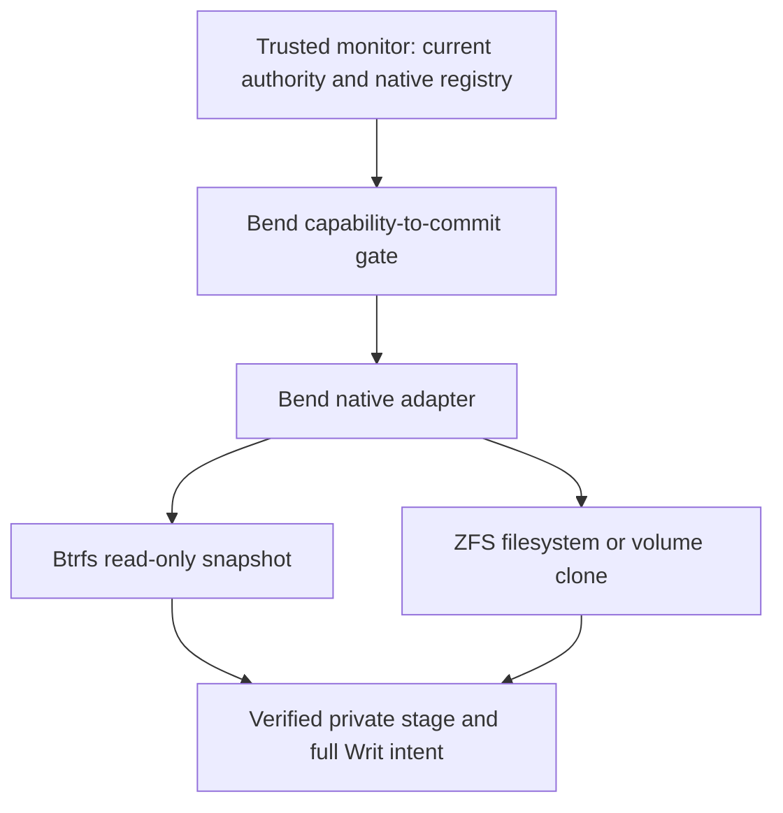

# WritFS: native Btrfs and ZFS storage

WritFS adds a **Bend control layer over native storage units**. Btrfs snapshots
and ZFS clones perform the copy; Writ authorizes the exact operation and retains
its origin restrictions. Payloads do not pass through a file-copy loop or a FUSE
daemon. The first implemented operation creates a **private, read-only stage**.

| Backend | Source | Native operation | Private result |
| --- | --- | --- | --- |
| `btrfs` | Read-only leaf subvolume | Read-only subvolume snapshot on the same filesystem | Snapshot beneath a canonical, owner-only staging directory |
| `zfs` | Snapshot of a leaf filesystem dataset | Clone in the same pool | Read-only filesystem with `canmount=off`, `mountpoint=none`, and sharing disabled |
| `zvol` | Snapshot of a ZFS block volume | Clone in the same pool | Read-only block volume with `volmode=none` and hidden snapshot devices |

**The zvol backend is actual block-volume integration.** A Btrfs subvolume is a
native filesystem tree with shared extents, not a separately addressable block
device. Its snapshot operation still avoids walking and copying individual
files. These distinctions follow the upstream [Btrfs subvolume
contract](https://btrfs.readthedocs.io/en/latest/Subvolumes.html) and
[OpenZFS volume model](https://openzfs.github.io/openzfs-docs/Basic%20Concepts/Datasets/ZVOLs.html).

This is an executable storage backend, not yet a mounted POSIX filesystem,
public block-device service, or complete Writ host. It does not implement
writable workspaces, arbitrary transforms, durable logical publication, or a
general plaintext Open. Its administrative CLI uses explicitly synthetic
authority for **public fixtures only**.
The operator must supply those public fixtures. The CLI accepts any structurally
supported selector; it does not classify contents or authenticate a production
authority issuer.

## Where it fits



The monitor registers a sealed native unit as a logical `Transfer.ObjectVersion`.
It supplies the original dependency graph, current descriptor and registry,
session, ledger, and approved destination. `Native.authorize` calls
`DataOS.commit_from_capability`; native storage does not add another release
route. Each backend has its own registered operation identity.

`Host.execute` re-observes the source and validates the private destination before
invoking literal argv for `btrfs` or `zfs`. It then re-observes the source, new
native object, and staging controls. A successful receipt includes the **complete
accepted write intent**, output policy, DLM label, committed model state, and
created native identity. A path existing after a command is insufficient.

The host uses installed upstream command-line tools as its native bindings.
All authored planning, validation, execution sequencing, and tests are Bend.
There is no new Go or C implementation. Each operation incurs subprocess and
metadata-inspection overhead; ordinary native data I/O is not proxied through
Bend. No throughput or latency benchmark is claimed.

## Build and inspect

Use the repository's pinned [Bend 2.0.39 toolchain](../docs/INSTALL.md), a native
C compiler, Linux, and the matching native filesystem utilities/kernel modules.
Build artifacts belong outside the checkout:

```sh
mkdir -p ../writfs-build
bend writfs/Main.bend -o ../writfs-build/writfs

sudo ../writfs-build/writfs inspect btrfs /srv/writ/sealed/report
sudo ../writfs-build/writfs inspect zfs tank/reports@approved
sudo ../writfs-build/writfs inspect zvol tank/volumes/report@approved
```

Inspection reports native IDs and admission-relevant flags. An observed writable
or non-leaf unit is not thereby an admissible source: sealing and authorization
reject it. An ordinary directory cannot stand in for a Btrfs subvolume root.
Inspection is a local trusted-operator tool, not an authenticated remote API.

For a public fixture in an isolated native store, prepare a private staging
parent on that same filesystem/pool. A Btrfs parent must be a canonical directory
owned by the effective user with mode exactly `0700`. A ZFS parent must be an
existing filesystem dataset with `canmount=off`, `mountpoint=none`, and
`sharenfs=off`/`sharesmb=off`. These example paths must already refer to your
deliberately prepared fixture:

```sh
sudo ../writfs-build/writfs example-copy btrfs \
  /srv/writ-fixture/sealed /srv/writ-fixture/staging copy
sudo ../writfs-build/writfs example-copy zfs \
  fixturepool/input@sealed fixturepool/staging copy
sudo ../writfs-build/writfs example-copy zvol \
  fixturepool/volume@sealed fixturepool/staging volume-copy
```

The CLI refuses an existing destination. It never formats storage, imports pools,
deletes snapshots, exports a created device, or publishes a logical object.
Exit `0` means a verified private stage; `1` means refusal; `2` means invalid CLI
usage; `3` means the native outcome is unknown and needs operator recovery.
The example does not persist a registry or serialize its receipt across restarts.

## Embedding the Bend backend

| Entry point | Contract |
| --- | --- |
| `Host.observe(provider, locator)` | Bounded read-only inspection; returns native facts or an error |
| `Native.seal(source)` | Validates a whole immutable source and hashes its canonical native descriptor |
| `Native.preview(spec)` | Describes the exact native argv; grants no authority |
| `Native.authorize(spec, gate)` | Runs the existing complete capability-to-commit gate and returns its exact state and intent |
| `Host.execute(authorized)` | Rechecks the source/destination, performs one native creation, and verifies the result |
| `Host.reconcile(receipt)` | Rechecks a previously recorded exact receipt without creating or adopting anything |

`Destination.container` is the **FSID or pool GUID**, not a directory/dataset
path. `Destination.locator` is the full target path or dataset name. The host
derives the physical staging parent from that locator. Logical object/version
IDs are separate monitor-issued values; no UUID or GUID is truncated into one.

The monitor must retain the returned session and ledger even when subsequent
native execution fails. A model commit and a native creation are not an atomic
durable transaction. Do not reconstruct authority, refund a charge, or replay a
mutation by copying an old in-memory gate. Paid operation recovery belongs to
the separate durable-publication work.

`Authorized`, `Gate`, and `Receipt` are public Bend data records. They are not
unforgeable capabilities, authenticated messages, or durable journal entries.
The canonical sequence is observation/registration, `Native.authorize` with
current monitor-owned state, then `Host.execute`. Exported helpers are
implementation details; their structural consistency checks do not authenticate
caller-constructed records. See the core [authority contract](../LIBRARY.md).

## Identity, sealing, and failures

Btrfs observations retain the full filesystem UUID, subvolume UUID, root ID,
generation, and creation generation. ZFS observations retain the full pool GUID,
object GUID, and creation transaction group. Unsigned 64-bit native numbers stay
canonical decimal strings; all their bits survive comparison.

Btrfs snapshot creation can itself advance the read-only source's root
generation. Preflight still requires the exact sealed observation. After the
copy, the only permitted source change is a strictly increasing generation that
equals both the new snapshot's generation and its creation generation; every
other source field must remain identical. The receipt preserves the original
seal and the new snapshot's full identity. A later unrelated source generation
does not reconcile under that receipt. A new operation starts with a fresh
observation and source seal.

Reconciliation requires the created observation to match the receipt exactly.
The source may match the original sealed observation or that one permitted
Btrfs transaction relation. The receipt does not record which source variant
completion observed; it does not establish a history of intermediate changes.

The displayed SHA-256 identifies the versioned **native source-seal manifest**.
It does not hash every payload byte, provide rclone's content-checksum semantics,
or independently attest the filesystem implementation. Exact native source
identity and the checked native copy operation associate that manifest with the
result. `lib/Sha256.bend` is shared with the rclone contribution; the two uses
have different artifact semantics.

The adapter rejects writable sources, non-leaf units, malformed or ambiguous
native metadata, wrong filesystems/pools, changed observations, destination
collisions, and substituted commands. Btrfs snapshots are not recursive across
nested subvolumes, so rejecting those sources avoids silently dropping content.
The initial ZFS profile also requires a leaf parent dataset.

Tool output is capped at 65,536 combined bytes and commands at 15 seconds. The
runtime returns an error on overflow or timeout; truncated output is not accepted.
Commands run without a shell, with a cleared environment, `LC_ALL=C`, and a fixed
system executable path. Native locators use a deliberately bounded ASCII subset:
letters, digits, `_`, `.`, `-`, `/`, and the single snapshot `@` delimiter. No
empty, dot, dot-dot, leading-dash component, or path longer than 512 characters
is accepted. Command diagnostics returned by the host are fixed codes, not raw
tool output.

A failure before native mutation is `Refused`. Once mutation was attempted,
failure or an unverifiable postcondition is `Unknown`: a timeout can still leave
an object behind. There is no blind retry, adoption by path, automatic rollback,
or deletion. `reconcile` requires a receipt with an already recorded created
identity; it cannot discover trustworthy ownership of an unrecorded crash result.

## Trust boundary and remaining work

The executable paths, registered roots, source seals, policy mappings, and
administrative native authority belong to a **trusted single writer**. Calls must
be serialized against that monitor's current state. Canonical path rechecks do
not pin directory descriptors or defend against a hostile administrator swapping
paths, pools, devices, or properties between checks.

In particular, a ZFS clone's GUID and `createtxg` identify its creation, not a
content version. Reconciliation checks current identity and controls; it cannot
detect a privileged actor making a clone writable, editing it, and restoring its
properties between observations. A read-only result is protected only within
the stated administrative ownership boundary.

A production host still needs authenticated subject binding, native/logical
registration, a durable intent/receipt journal, serialized state application,
recovery of uncertain effects, and an authorized presentation boundary. The
existing [Linux host](../openspec/changes/add-linux-host/proposal.md) and
[durable-publication](../openspec/changes/add-durable-publication/proposal.md)
tasks remain pending. Native storage success is not evidence of arbitrary-worker
confinement, revocation of issued handles, or complete egress mediation.

FUSE can later provide a directory view. Linux
[FUSE passthrough](https://docs.kernel.org/filesystems/fuse/fuse-passthrough.html)
can keep selected data operations on backing files, but handing out a readable
descriptor is still a policy decision and its kernel references have their own
lifetime. It does not supply Writ's missing confinement or revocation boundary.
ZFS zvol export similarly needs separately authorized device access.

## Tests and source layout

### Relationship to the rclone contribution

The existing [rclone remote](../contrib/rclone/README.md) remains a bounded,
memory-only contribution. It is not automatically backed by these native units.
A native storage service could present a registered subvolume, dataset snapshot,
or zvol snapshot as a versioned object and route a managed server-side Copy
through this backend. It would first need durable logical/native registration
and receipts, plus an authenticated API for the current monitor state.

That service must not advertise the native manifest seal as rclone's SHA-256
content hash. It must also keep a terminal denial from becoming a generic Open
or download fallback. Individual file browsing and writable mounts are separate
presentation choices; neither is needed for the native snapshot/clone path.

### Reproduction

Run the pure model and host-parser/runtime checks with both Bend backends:

```sh
bend writfs/Tests.bend
bend writfs/HostTests.bend
bend writfs/Tests.bend -o ../writfs-build/tests
../writfs-build/tests +RTS --threads 4 --gpu off
bend writfs/HostTests.bend -o ../writfs-build/host-tests
../writfs-build/host-tests +RTS --threads 4 --gpu off
```

The [native workflow](../.github/workflows/writfs-native.yml) provisions new
regular-file-backed storage on a disposable VM and executes
`NativeIntegration.bend`. Bend owns the assertions. Cleanup touches only the
loop device, mount, or pool that the same job successfully created. Missing
kernel support fails the lane. The fixture contains only public test text.
See [VERIFICATION.md](VERIFICATION.md) for results and exact evidence limits.

| Source | Responsibility |
| --- | --- |
| `Native.bend` | Typed units, full identities, source sealing, plan binding, facade authorization, native postconditions and receipts |
| `Host.bend` | Bounded native inspection, private staging validation, literal argv execution and exact reconciliation |
| `Main.bend`, `examples/Authority.bend` | Trusted-operator CLI and explicitly synthetic authority for public fixtures |
| `Tests.bend`, `HostTests.bend`, `NativeIntegration.bend` | Model, parser/runtime, and real filesystem checks |
| `../lib/Sha256.bend` | Shared Bend SHA-256 implementation |
